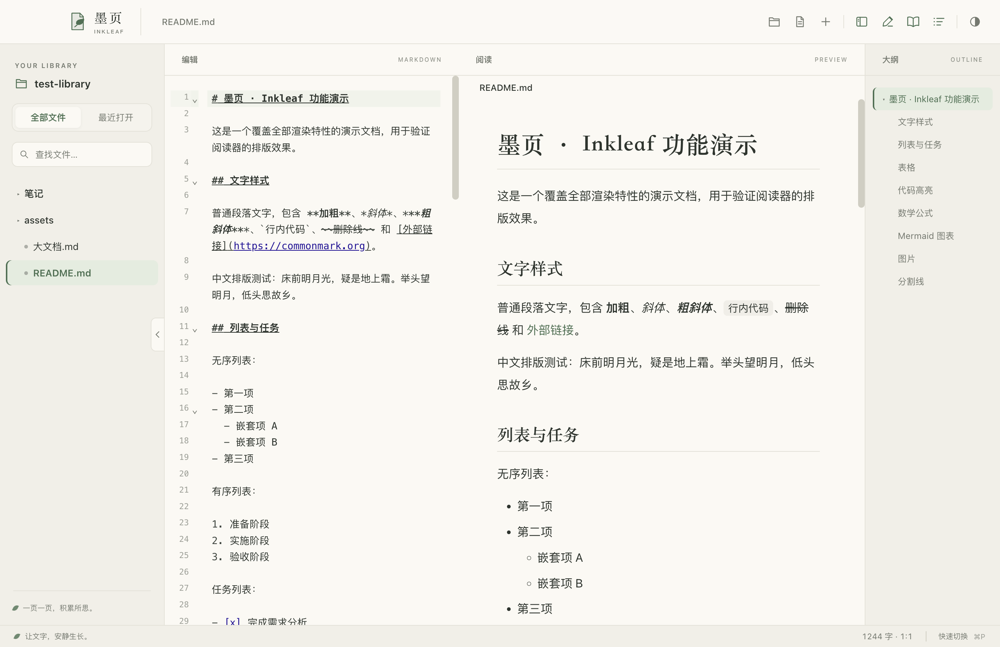
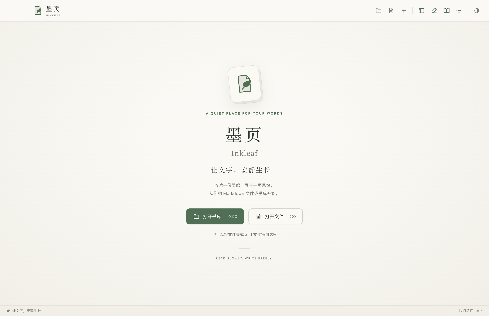
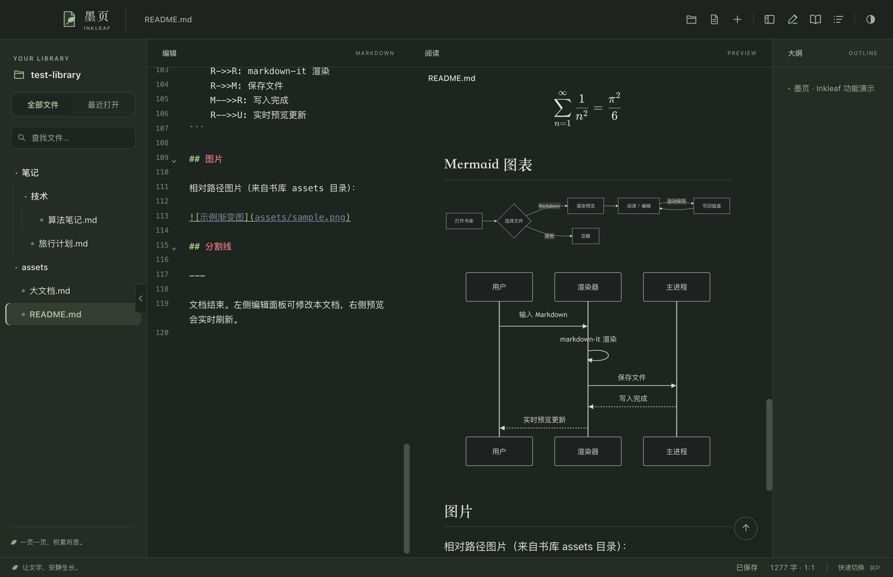

# 墨页 · Inkleaf

让文字，安静生长。

面向 macOS 与 Linux 的个人 Markdown 阅读与编辑器。暖白纸面、墨色文字与叶绿色点缀，让阅读与写作回归舒适、专注。



## 快速开始

源码开发需要 Node.js 与 npm。Linux 还需要 GCC，每次 `build`、`start` 或 UI 测试都会编译原生更新助手，可先运行 `sudo apt install build-essential`；构建安装包另需 `dpkg` 和 `fpm`。下载好的 `.deb` 或 AppImage 已包含运行时与助手，日常运行不需要安装 Node.js 或 GCC。

```bash
npm install       # 安装依赖（.npmrc 已配置国内镜像）
npm start         # 开发模式启动
npm run test:ui   # 使用独立配置和测试书库副本，回归验证并截图到 verify/
npm run package   # 生成图标并打包 dist/mac-arm64/Inkleaf.app
npm run release:build # 构建 app，以及供软件内更新使用的 ZIP 和 SHA-256 文件
npm run release:linux # 在原生 Linux x64/arm64 上构建 AppImage、deb 与 SHA-256 文件
```

把 `Inkleaf.app` 拖入 `/Applications` 即可日常使用；Finder 中右键任意 `.md` 文件 → 打开方式 → 墨页 · Inkleaf。

### Linux 安装

0.3.0 提供 x64 与 arm64 的 AppImage 和 Debian 安装包。发布验证矩阵覆盖 Ubuntu 22.04 x64、Ubuntu 24.04 x64 与 Ubuntu 24.04 arm64；Debian 建议使用 12 或更新版本，尚未单独实测 Debian。旧版 glibc 系统不在本次兼容性承诺中。Ubuntu/Debian 桌面优先安装 `.deb`，会添加应用菜单入口与 Markdown 文件关联：

```bash
sudo apt install ./Inkleaf-0.3.0-linux-x64.deb
inkleaf /path/to/document.md
```

便携使用可以下载 AppImage，赋予执行权限后直接启动；arm64 机器把文件名中的 `x64` 换成 `arm64`：

```bash
chmod +x Inkleaf-0.3.0-linux-x64.AppImage
./Inkleaf-0.3.0-linux-x64.AppImage
```

AppImage 的 FUSE 运行方式需要 FUSE 2 兼容库（Ubuntu 22.04 的 `libfuse2`，Ubuntu 24.04 的 `libfuse2t64`）。Ubuntu 24.04 的 AppArmor 可能限制便携应用创建用户命名空间；遇到沙箱启动错误时，请优先安装 `.deb`。正常安装的 `.deb` 会为 root 所有的 Chromium 沙箱助手设置正确权限，保留浏览器沙箱。CI 对便携版使用仅针对 Inkleaf 路径的测试配置，不能据此承诺任意 Ubuntu 24.04 桌面默认配置都能直接运行 AppImage。

Linux 使用 Ctrl 快捷键与系统窗口边框，支持从命令行、文件管理器或「打开方式」打开 Markdown 文件。原有阅读、编辑、搜索、主题、图片和 PDF/HTML 导出功能保持同一套界面。

## 软件内更新

已打包的应用会在启动后检查 [GitHub Releases](https://github.com/Fovercon/Inkleaf/releases) 中的正式新版本，也可以通过菜单或工具栏的「检查更新…」手动检查。macOS 应用与 Linux AppImage 可以在软件里下载；下载完成并确认重启后，应用会替换自身并重新打开。更新包会核对 GitHub 提供的 SHA-256 摘要、应用标识、版本与 CPU 架构。书库、Markdown 文件与原有设置继续保留。

Linux `.deb` 由系统包管理器安装，软件只检查新版本并提供下载入口，随后使用 `apt install ./新版本.deb` 更新；不会让应用自行替换系统目录。AppImage 的软件内更新要求文件和所在目录可由当前用户写入。

macOS 0.1.0 没有更新器，需要先手动安装一次 0.2.2 或更新版本。0.2.2 修复了 0.2.0/0.2.1 在 GitHub 下载重定向时可能失败的问题；如果旧版无法完成下载，也可以直接安装新版。开发模式不执行更新；草稿和预发布版本不会进入更新渠道。macOS 目前提供 Apple Silicon（arm64）更新包，应用目录需要当前用户拥有写入权限。

这是为已经在这台 Mac 上允许运行的 Inkleaf 提供的个人自助更新方式。当前构建没有 Apple Developer ID 签名与公证，更新器不会关闭 Gatekeeper，也不会移除下载文件的隔离属性；如果 macOS 拦截新版，按系统的「隐私与安全性」提示操作。面向公开分发时，应为应用添加 [Developer ID 签名与 Apple 公证](https://developer.apple.com/documentation/security/notarizing-macos-software-before-distribution)。

## 发布新版本

将 `package.json` 和 `package-lock.json` 的项目版本一起升级（例如 0.3.1），提交修改后推送对应的 `v0.3.1` 标签。标签版本必须与 `package.json` 完全相同，发布渠道仅接受 `x.y.z` 正式版本。

仓库的「Build release」工作流同时构建 macOS arm64、Linux x64 与 Linux arm64。Linux 在真实 Ubuntu runner 上运行原有 UI 回归、平台快捷键检查，并验证打包的 AppImage 和实际安装的 `.deb`；另外复用 Ubuntu 22.04 的 x64 产物在 Ubuntu 24.04 再次验证。所有平台通过后，由一个发布任务汇总完整附件并生成同一份 Release 草稿。以 0.3.0 为例：

- `Inkleaf-0.3.0-mac-arm64.zip`：ZIP 根目录是 `Inkleaf.app`，保留应用包的符号链接。
- `Inkleaf-0.3.0-linux-x64.AppImage` / `.deb`：x64 便携版与 Debian 安装包。
- `Inkleaf-0.3.0-linux-arm64.AppImage` / `.deb`：arm64 便携版与 Debian 安装包。
- 每个附件都有同名 `.sha256` 文件，供手动下载时核对。

推送标签默认生成 GitHub Release **草稿**。检查完整的平台附件与版本说明后，在 GitHub 点击「Publish release」即可让软件发现更新；也可以手动运行工作流，填写现有标签并勾选 `publish`，待全部平台验证通过后再统一发布。重跑工作流可以补齐或重建同一草稿的附件，已经发布的版本会拒绝覆盖，修复应发布新的版本号。客户端只读取公开的正式 Release，无需登录 GitHub，应用中不包含发布令牌。

也可以在本机准备同样的附件：

```bash
npm run typecheck
npm run test:updates
npm run test:platform
# macOS arm64
npm run release:build
# 或在对应架构的原生 Linux 上构建；需要 gcc、dpkg 与 fpm 打包工具
npm run release:linux -- --arch x64
npm run release:linux -- --arch arm64
cd dist
shasum -a 256 -c Inkleaf-0.3.0-mac-arm64.zip.sha256
# Linux：sha256sum -c Inkleaf-0.3.0-linux-x64.AppImage.sha256
```

本机构建命令只生成文件，不上传或发布。Linux 构建要求宿主架构与目标一致，确保更新助手和实际启动检查使用同一架构。发布时将全部五个应用附件与校验文件一起上传到同版本 Release；发布脚本核对完整附件集、本地 SHA-256 和 GitHub 返回的资产摘要，避免把半成品标为最新版本。客户端使用 GitHub API 返回的资产摘要核验下载，而非把旁边的校验文本文件作为独立信任来源。

## 视觉设计

- 暖白纸面 `#FBF9F4`、墨色文字 `#2C342E`、叶绿点缀 `#487052`。
- 书页与叶片标识、统一 SVG 线条图标、宋体标题与清晰的面板层级。
- 欢迎页、书库、编辑器、阅读预览、大纲与底部状态栏采用一致的配色。
- 保留五套主题和字号调节；小窗口自动分配面板空间，键盘焦点清晰可见。





应用图标将展开的书页与绿叶融为一体，采用暖白底色和轻微纸张折叠质感。源图稿保存在 `build/inkleaf-icon.png`；运行 `npm run icon` 可生成包含 16–1024 像素资源的 `build/icon.icns`。图稿由内置 ImageGen 生成，完整提示词见 [icon-prompt.txt](build/icon-prompt.txt)。

## 功能总览

**阅读**
- 文件夹书库：文件树（展开状态记忆）、最近文件、树内过滤（高亮匹配）
- 渲染：GFM 表格/任务列表、代码高亮、KaTeX 数学公式、Mermaid 图表（懒加载 + 缓存）、相对路径图片（`mdasset://` 安全协议）
- 排版：16px 正文 / 1.8 行高，图片点击全屏灯箱（滚轮缩放、拖拽平移）
- 大纲：折叠子树、点击跳转、滚动跟随高亮
- 面包屑：点击文件夹在树中展开定位；返回顶部按钮
- 主题：自动 / 浅色 / 羊皮纸 / 护眼绿 / 深色；字号缩放 80%–160%

**编辑**
- CodeMirror 6 编辑器，GFM 语法高亮，⌘S + 2 秒自动保存（macOS 原生未保存圆点）
- 快捷键：⌘B 加粗 / ⌘I 斜体 / ⌘E 行内代码 / ⇧⌘K 代码块 / ⌘K 链接（智能切换）
- 列表 Enter 自动续行、Tab/⇧Tab 缩进；任务复选框点击回写源码
- 粘贴图片自动存 `assets/paste-时间戳.png` 并插入引用
- 编辑 ⇄ 预览双向滚动同步；字数与行列统计

**文件管理**
- 右键：新建文件/文件夹（行内命名）、重命名（路径级联联动）、删除（系统废纸篓）、系统文件管理器定位
- 拖拽：文件拖入文件夹整理；外部文件夹/文件拖入窗口打开

**搜索**
- ⌘P 快速切换：文件名模糊匹配（评分排序 + 字符高亮），空查询显示最近
- ⇧⌘F 全书库全文搜索：按文件分组、行号 + 关键词高亮、点击直达行

**导出**
- ⇧⌘P 导出 PDF（A4、打印背景、分页防截断）
- ⇧⌘H 导出单文件 HTML（样式 + 图片 + KaTeX 字体全部内嵌，零依赖）

**macOS 集成**
- `.md`/`.markdown` 文件关联、Dock 菜单（含最近文件）、标题栏代理文件图标、自定义应用图标

## 快捷键速查

下表使用 macOS 符号；Linux 将 ⌘ 换为 Ctrl、⇧ 换为 Shift，例如保存是 Ctrl+S，全文搜索是 Ctrl+Shift+F。

| 快捷键 | 功能 | | 快捷键 | 功能 |
|---|---|---|---|---|
| ⌘O / ⇧⌘O | 打开文件/文件夹 | | ⌘P | 快速切换文件 |
| ⌘N | 新建文件 | | ⇧⌘F | 全文搜索 |
| ⌘S | 保存 | | ⇧⌘P / ⇧⌘H | 导出 PDF/HTML |
| ⌘\ ⌘1 ⌘2 ⌘3 | 切换书库/编辑/预览/大纲 | | ⌘= ⌘- ⌘0 | 字号缩放 |
| ⌘B ⌘I ⌘E ⌘K | 加粗/斜体/代码/链接 | | ⇧⌘W | 关闭书库 |

## 架构

```
src/main       Electron 主进程：窗口、菜单、文件 IPC、chokidar 监听、
               mdasset/app 自定义协议、打印导出、Dock 菜单、会话
src/preload    contextBridge 安全 API（contextIsolation 开启）
src/renderer   渲染层（无框架 TypeScript）：
               main 布局总装 / fileTree / editor(CodeMirror) /
               preview(markdown-it 管线) / outline / lightbox /
               commandPalette / export / theme / state
```

技术栈：Electron + TypeScript + esbuild；CodeMirror 6；markdown-it + DOMPurify + highlight.js + KaTeX + Mermaid（懒加载分包）；chokidar；electron-builder。

安全：contextIsolation、CSP、DOMPurify 消毒、`mdasset://` 协议限定书库根目录内。

## 迭代历史

项目经 10 轮自动化迭代打磨，过程记录见 [ITERATION-LOG.md](ITERATION-LOG.md)，每轮均有截图证据（verify/）与 git 提交。

| 轮 | 主题 | 轮 | 主题 |
|---|---|---|---|
| 0 | MVP 基线 | 5 | 全文搜索 + 快速切换 |
| 1 | 阅读排版 + 图片灯箱 | 6 | 导出 PDF / HTML |
| 2 | 编辑体验 + 任务回写 + 贴图 | 7 | 五套主题 + 字号缩放 |
| 3 | 导航：面包屑/最近/大纲折叠 | 8 | 性能（缓存/防抖/双渲染修复） |
| 4 | 文件管理：重命名/删除/过滤 | 9 | macOS 原生集成 |
|  |  | 10 | 终检 + 树内拖拽 + 交付 |
