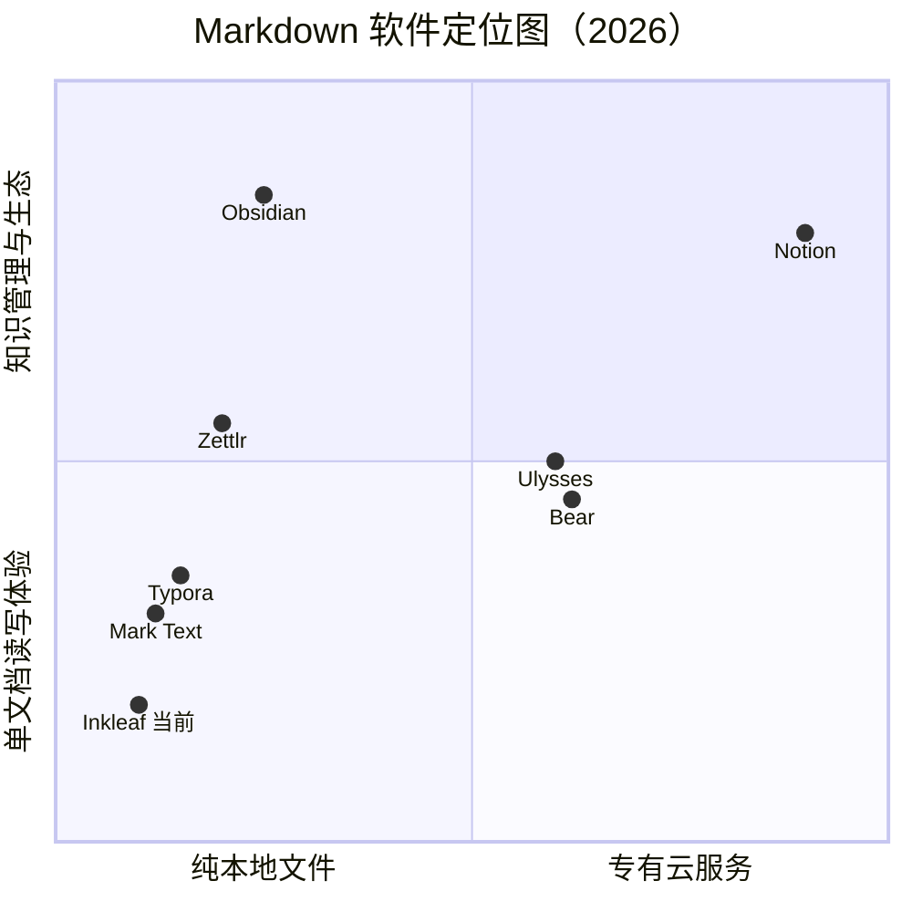

# Inkleaf 功能差距深度分析（调研第 1 轮）

> 日期：2026-10-14 · 对比基准：Typora / Obsidian / Zettlr / Bear / Ulysses / Mark Text / VS Code
> 方法：官方文档与功能清单检索（4 组多角度 WebSearch）+ 本仓库源码与 README 实测清点
> 用途：为第 2 轮《优化路线方案》提供输入；本文只做事实与判断，不做排期

---

## 一、执行摘要（五条关键判断）

1. **Inkleaf 在"单文档读写体验"维度已接近第一梯队**（Typora 级）：排版、主题、灯箱、导出单文件 HTML、性能缓存等达到甚至局部超越；真正的断层差距集中在**知识管理层（双链/标签/属性/图谱）**，这一层我们几乎是零。
2. **差距最大的单项是插件生态**（Obsidian 2000+ 插件 vs 我们为 0）。这与用户既定目标（插件化架构）完全一致——它不是"补一个功能"，而是补一个**能力放大器**，优先级应高于大多数单项功能。
3. **编辑器代差仍然存在**：我们所见即所得（WYSIWYG）缺席、表格/脚注等复杂结构无专用编辑器、无专注/打字机模式。Typora 的核心竞争力恰是"无感 Markdown"，这是我们最直观的体验差距。
4. **导出链只有半条**：PDF/单文件 HTML 质量不错，但 Pandoc 全家桶（Word/LaTeX/EPUB/DOCX 学术流）与静态发布（网站）缺失，学术与分享场景不可用。Zettlr 内置 Pandoc 的做法值得借鉴。
5. **协作模型本轮改版质量高、方向正确**：品牌（墨页）、自动更新、Linux、CI、测试补的都是"产品化地基"，恰好是插件分发与 AI 能力上线的前置条件；但未触及任何知识管理或编辑器代差问题。

---

## 二、对比对象与维度设计

### 2.1 为什么选这些标杆

| 标杆 | 代表的路线 | 对 Inkleaf 的参照意义 |
|------|-----------|----------------------|
| Typora | 极致单文档写作（WYSIWYG） | 编辑体验的天花板，最直接对手 |
| Obsidian | 本地优先 + 知识管理 + 生态 | 知识管理与插件体系的最优解 |
| Zettlr | 学术写作（Pandoc/引用/Zettelkasten） | 导出链与学术场景参照 |
| Bear / Ulysses | 标签组织 / 长文写作（云服务） | 组织形态与写作增强的参照 |
| Mark Text | 开源免费分屏编辑 | 同路线开源对手（已近乎停更，2022 后不活跃） |
| VS Code | 编辑器平台化 | "编辑器即平台"的架构参照（第 4 轮展开） |

### 2.2 定位象限

**判断**：Inkleaf 位于左下角（本地、单文档体验）。向左上（本地 + 知识管理）移动是唯一无人占满且与我们基因匹配的方向——Obsidian 之外，"安静、本地、中文体验好、可插件化"的位置是空的。

---

## 三、功能矩阵总览

图例：● 完整支持 ◐ 部分支持/需折腾 ○ 不支持

| 维度 | Inkleaf | Typora | Obsidian | Zettlr | Bear | Ulysses |
|------|:---:|:---:|:---:|:---:|:---:|:---:|
| GFM 渲染（表格/任务） | ● | ● | ● | ●(Pandoc方言) | ● | ●(XL方言) |
| 数学公式 KaTeX/MathJax | ● | ● | ● | ●(LaTeX级) | ◐ | ◐ |
| Mermaid 图表 | ● | ● | ●(插件/原生) | ● | ○ | ○ |
| 图片灯箱/缩放 | ● | ◐ | ◐(插件) | ○ | ● | ◐ |
| 五套以上主题 | ●(5套) | ●(装主题) | ●(社区) | ◐ | ● | ● |
| 字号缩放 | ● | ●(缩放) | ◐ | ◐ | ◐ | ● |
| 分屏编辑+预览 | ● | ◐(可切) | ◐(插件) | ● | ○ | ◐ |
| 所见即所得 WYSIWYG | ○ | ● | ◐(Legacy) | ○ | ● | ◐ |
| 专注/打字机模式 | ○ | ● | ●(插件) | ● | ◐ | ● |
| 表格可视化编辑 | ○ | ◐ | ◐(插件) | ◐ | ◐ | ◐ |
| 脚注/定义列表渲染 | ○ | ● | ●(方言) | ● | ◐ | ◐ |
| 大纲面板 | ● | ● | ● | ● | ◐ | ● |
| 双向链接/反链面板 | ○ | ○ | ● | ◐ | ◐(wiki链接) | ○ |
| 标签系统/标签面板 | ○ | ◐ | ● | ◐ | ●(嵌套标签) | ◐ |
| Frontmatter 属性面板 | ○ | ◐ | ● | ●(Pandoc选项) | ○ | ○ |
| 关系图谱 | ○ | ○ | ● | ◐ | ○ | ○ |
| 白板/Canvas | ○ | ○ | ● | ○ | ○ | ○ |
| 文件夹书库 | ● | ◐ | ●(Vault) | ●(项目) | ◐(标签替代) | ◐(组) |
| 文件管理（重命名/删除/拖拽） | ● | ◐ | ● | ● | ● | ● |
| 树内过滤 | ● | ○ | ◐ | ◐ | ◐ | ◐ |
| 模糊快速切换 | ● | ○ | ● | ○ | ● | ◐ |
| 全文搜索 | ● | ◐(单文件) | ●(正则/上下文) | ● | ● | ● |
| 搜索结果过滤/保存搜索 | ○ | ○ | ● | ◐ | ●(智能过滤) | ● |
| 多标签页 | ○ | ● | ● | ● | ●(面板) | ◐ |
| 工作区/布局保存 | ○ | ○ | ● | ○ | ○ | ◐ |
| 导出 PDF | ● | ● | ● | ● | ● | ● |
| 导出单文件 HTML（内嵌资源） | ● | ◐(图片外置) | ○ | ◐ | ◐ | ◐ |
| Pandoc 导出（Word/LaTeX/EPUB） | ○ | ●(外装Pandoc) | ●(插件) | ●(内置) | ◐ | ◐ |
| 引用/文献管理 | ○ | ○ | ◐(插件) | ● | ○ | ○ |
| 发布为网站 | ○ | ○ | ●(Publish付费) | ○ | ●(付费) | ◐ |
| 自动更新 | ● | ● | ● | ● | ● | ● |
| 跨平台 | ◐(mac+linux) | ● | ● | ● | ◐(Apple) | ◐(Apple) |
| 移动端 | ○ | ○ | ● | ○ | ● | ●(iPad) |
| 同步方案 | ○(自管文件夹) | ○(自管) | ●(Sync付费) | ○(自管) | ● | ● |
| 插件体系 | ○ | ○ | ●(2000+) | ○ | ◐(受限) | ◐(受限) |
| 命令面板 | ● | ◐ | ● | ◐ | ○ | ◐ |
| 模板系统 | ◐(新文件模板) | ○ | ● | ● | ◐ | ● |
| 每日笔记/日记 | ○ | ○ | ● | ◐ | ◐ | ◐ |
| AI 能力 | ○ | ○ | ◐(社区插件) | ○ | ◐ | ◐ |
| 中文/排版体验 | ● | ● | ◐ | ◐ | ● | ◐ |

---

## 四、分维度差距深度分析

### A. 编辑体验（差距等级：★★★ 明显落后）

- **WYSIWYG**：Typora 的立身之本。我们的"分屏 + 即时预览"是务实路线（VS Code/Obsidian 主流同款），但对轻度用户仍有门槛。完全 WYSIWYG 成本极高（Typora 打磨了 8 年）；**务实的中间态**是：表格/链接/图片的行内弹层编辑、Markdown 标记的悬停隐藏（读态）——成本低很多。
- **专注/打字机模式**：Typora/Zettlr/Ulysses 标配（高亮当前段落、内容居中滚动）。实现成本低（CSS + 滚动定位），**性价比极高的补齐项**。
- **复杂结构编辑**：表格增删行列、脚注跳转、链接编辑弹层——标杆都有专用 UI，我们全靠手写源码。
- **多标签页**：Typora/Obsidian/Zettlr 均有。我们单文档打开，频繁对照两个文件时体验断裂。这是**用户可感知度最高的结构性缺失**。

### B. 渲染能力（差距等级：★ 基本持平，局部领先）

已达标：GFM、KaTeX、Mermaid（懒加载+缓存+全标签渲染）、代码高亮、图片灯箱。
缺失（低成本补齐）：**脚注**（markdown-it-footnote 插件级）、**定义列表**、`[TOC]` 语法、**admonition/callout**（Obsidian 的 `> [!note]` 已成事实标准，兼容它=白捡兼容性）、任务列表日期高亮等细节。
判断：渲染层我们接近满分，属于"最后 5% 的打磨"。

### C. 知识管理（差距等级：★★★★★ 断层，核心战场）

Obsidian 的护城河 = 双链 + 反链 + 标签 + 属性 + 图谱 + Canvas + 生态。我们为零：
- **双链 `[[...]]`**：渲染时识别并变成内部链接 + 悬停预览卡片（page preview）——这是把"文件夹"升级为"知识网络"的第一块砖；
- **反链面板**：当前文档被谁引用（Obsidian 用户留存的核心功能，调研中反复被提及）；
- **标签系统**：`#tag` 与 `#nested/tag`（Bear 用标签完全替代文件夹，证明这是强需求）+ 标签面板聚合；
- **Frontmatter 属性**：YAML 头的结构化编辑与检索（Obsidian Properties / Zettlr 的 Pandoc 选项都基于此）；
- **图谱**：有了双链之后自然长出（力导向图），是营销亮点而非刚需；
- **Canvas/白板**：重投入，暂不建议（第 2 轮排低优先级）。

### D. 视图与工作区（差距等级：★★★ 结构缺失）

多标签页（见 A）、**分屏对照**（同库两文件并排）、**工作区布局保存**（Obsidian Workspaces：不同场景一键切换面板组合）。我们的面板体系（四面板可收起拖宽）底子不错，缺的是"多文档容器"这一层——这会直接影响第 4 轮插件架构的面板 API 设计（必须预留多 Tab 容器）。

### E. 文件管理（差距等级：★ 持平偏上）

树过滤、行内重命名/新建、废纸篓删除、拖拽整理、最近文件、面包屑定位——这套组合在标杆中属于完整水平。缺失：**多库/Vault 切换**（Obsidian 的 vault 概念）、**工作区级文件集合**（Zettlr 项目）、保存的智能文件夹（基于标签/属性的动态视图，Bear 智能过滤）——后两者依赖 C 层的标签/属性先落地。

### F. 搜索（差距等级：★★ 可用但浅）

已有：全书库全文 + ⌘P 模糊切换 + 命中行直达（这组合超过 Typora）。
缺：**正则/大小写/全字匹配开关**、**按标签/属性/路径过滤**（依赖 C 层）、**结果中多命中折叠**、保存搜索为智能视图、搜索结果替换（批量改写，Obsidian 有）。

### G. 导出与发布（差距等级：★★★ 半条链）

已有：PDF（分页控制）、单文件 HTML（全资源内嵌，超越 Typora 同类功能）。
缺：**Pandoc 导出链**（Word/LaTeX/EPUB/OPML；Zettlr 直接内置 Pandoc 二进制，Typora 要求用户自装——我们可选"检测到系统 Pandoc 则启用"的轻方案）、**引用文献**（学术场景，可后置）、**发布为静态网站**（本地生成目录，不依赖云；对标 Obsidian Publish 的免费替代，与"本地优先"定位自洽）。

### H. 协作/同步/多端（差距等级：★★ 但战略上可"不跟进"）

云同步（Bear/Ulysses/Notion）与移动端是大厂游戏。本地优先路线的合理答案：**文件夹即同步**（用户自选 iCloud/坚果云/Git）+ 文档说明推荐工作流。把资源集中在桌面体验，不分散。

### I. 平台与分发（差距等级：★★ 快速收敛中）

本轮改版后：macOS + Linux（AppImage/deb）、应用内自动更新（GitHub Releases）、CI 发布。仍缺 **Windows**（Electron 代码几乎零改动，主要是打包与测试矩阵的工程活，用户基数收益大）。

### J. 生态与扩展（差距等级：★★★★★ 零 → 目标态）

这是用户钦点的方向，也是 Obsidian 真正的护城河（2000+ 插件反哺主程序）。关键认知：**插件体系不是功能，是平台战略**——它决定第 2 轮路线图的骨架（先立扩展点，再长功能），详见第 4 轮设计文档。

### K. 性能与稳定性（差距等级：领先或持平）

大文档缓存渲染（96ms 重渲染）、防抖分级、并行树遍历、50+ 张截图回归链、445 行更新器测试——在同类开源产品中属上游水平。Mark Text 长期卡在性能与大文件问题上是其停滞的原因之一，我们已在正确的路上。

---

## 五、差距分级清单（第 2 轮的直接输入）

### P0 · 核心缺失（不做会在对比中"一眼出局"）

| # | 差距 | 关联层 | 预估量级 |
|---|------|--------|---------|
| 1 | 插件体系（架构先行） | 平台 | L（跨轮次） |
| 2 | 双链 [[ ]] + 悬停预览 | 知识管理 | M |
| 3 | 标签系统 + 标签面板 | 知识管理 | M |
| 4 | 多标签页容器 | 视图 | M（牵动面板架构） |
| 5 | Frontmatter 属性面板 | 知识管理 | S-M |
| 6 | 反向链接面板 | 知识管理 | M（依赖 #2） |
| 7 | 专注/打字机模式 | 编辑体验 | S |

### P1 · 体验差距（明显加分项）

- 脚注 / 定义列表 / `[TOC]` / Obsidian 风格 callout 渲染（渲染层打包补齐，S）
- 搜索增强：正则/过滤/结果折叠/批量替换（S-M）
- Pandoc 导出链（检测系统 Pandoc，M）
- Windows 平台支持（工程量 M，收益大）
- 表格/链接/图片的行内编辑弹层（M）
- 工作区布局保存、每日笔记模板（S）
- Vault 多库切换（S）

### P2 · 差异化押注（结合第 4/5 轮）

- 静态站点发布（本地生成，M）
- 本地优先 AI 能力（第 5 轮战略展开）
- 图谱视图（依赖双链，营销价值 > 使用价值）
- 白板 Canvas（重投入，暂缓）

### 已达成或超越项（保持并宣传）

- 单文件 HTML 导出（全资源内嵌，超 Typora）
- 树内过滤 + 行内重命名 + 拖拽整理组合
- 性能（大文档缓存渲染）与自动化回归链
- 五套内置主题 + 字号缩放开箱即用
- 应用内自动更新 + 双平台 CI（多数开源同类没有）

---

## 六、协作模型改版审视（f628183…be023f9，17 个提交）

| 方面 | 变更 | 评价 |
|------|------|------|
| 品牌 | 墨页 · Inkleaf、折纸+叶图标、暖白/墨色/叶绿视觉语言 | ✅ 定位清晰，与"安静阅读"叙事自洽；视觉资产已入库 |
| 产品化 | 应用内自动更新（GitHub Releases）、macOS 安装器 | ✅ 高价值：插件分发与 AI 功能上线的前置条件 |
| 平台 | Linux 支持（AppImage/deb）+ Ubuntu 24 验证 | ✅ 扩大基数；Windows 仍缺（见 P1） |
| 工程 | `src/shared` 平台抽象、`platform.ts`/`updater.ts`、445 行更新器测试、CI 发布 | ✅ 架构方向正确（平台差异收敛进 shared），为第 4 轮插件宿主的进程模型打了样 |
| 未触及 | 知识管理（双链/标签/属性）、多标签、WYSIWYG、搜索/导出增强 | ⚠️ 与本文 P0 清单一致——改版是"地基"不是"楼层"，方向没问题 |

**结论**：这轮改版与五轮调研形成互补：他们补了分发与地基，我们接下来的设计要补"楼层"（知识管理）与"骨架"（插件化）。

---

## 七、给第 2 轮的输入

1. 差距排序已明确：**插件架构 > 知识管理四件套（双链/标签/属性/反链）> 多标签容器 > 编辑模式补齐**。
2. 路线必须与第 4 轮插件设计咬合：多标签容器、面板系统、渲染管线都要按"可被插件扩展"来设计，避免先做死再重构。
3. "本地优先 + 中文体验 + 安静"是空白定位（象限图左上无人），第 2 轮的所有取舍应服务这一定位。
4. 不跟进清单：云同步、移动端、Canvas（重）、Notion 式协作。

## 参考来源

- [Obsidian 官网 / Canvas](https://obsidian.md) · [2025 Obsidian Report Card（核心插件清单）](https://practicalpkm.com/2025-obsidian-report-card)
- [Zettlr 4.0 发布说明（引用增强）](https://zettlr.com/post/zettlr-400-released) · [Zettlr Markdown 参考（Pandoc 方言/Mermaid）](https://www.markdownguide.org/tools/zettlr) · [LWN：Zettlr 内置 Pandoc](https://lwn.net/Articles/984502)
- [Typora：安装与使用 Pandoc](https://support.typora.io/Install-and-Use-Pandoc)
- [Bear vs iA Writer vs Ulysses（嵌套标签形态）](https://unmarkdown.com/blog/bear-vs-ia-writer-vs-ulysses) · [Bear vs Apple Notes（标签树）](https://www.atlasworkspace.ai/blog/bear-vs-apple-notes) · [Ulysses 发布说明（写作目标/智能过滤）](https://ulysses.app/en/releases)
- [2026 Markdown 编辑器横评（AI 原生品类出现）](https://nimbalyst.com/blog/the-complete-guide-to-markdown-editors) · [2026 八款对比](https://www.markdowntools.io/best-markdown-editors) · [本地优先选型指南](https://octarine.app/guides/best-local-first-markdown-app-for-writers)
- 本仓库：`git log f11e51f..be023f9`（协作模型改版提交）、README.md 功能总览、tests/ 与 src/shared 源码清点
