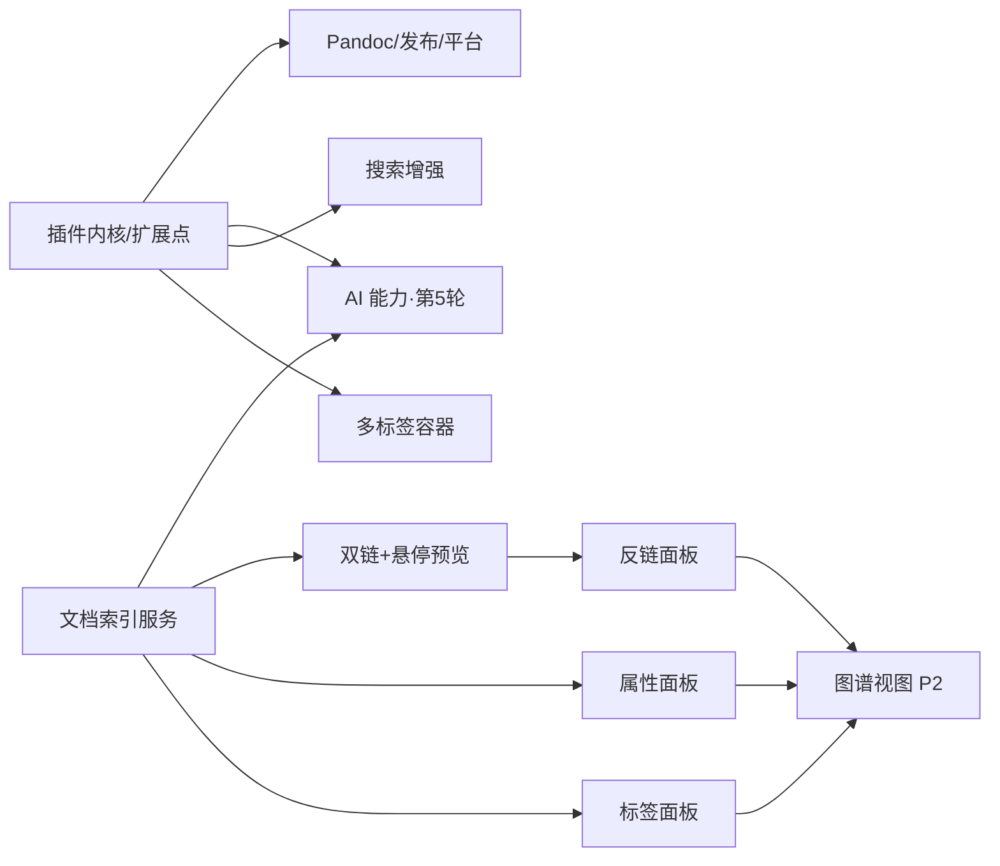

# Inkleaf 优化路线方案（调研第 2 轮）

> 日期：2026-10-14 · 输入：`docs/01-功能差距分析.md` 的 P0/P1/P2 清单
> 产出：优先级展开的方案卡、三阶段路线图、依赖关系、快速赢清单、验收度量
> 约束提醒：本文档为设计输入，具体实施排期待用户评审五轮后另行制定

---

## 一、总纲：取舍原则

第 1 轮确认的定位——**本地优先 · 知识管理 · 中文体验 · 安静**。所有排序服从四条原则：

1. **架构先行**：凡是"以后要被插件扩展"的东西（面板、渲染管线、编辑器、命令、索引），先立扩展点再堆功能，避免二次重写（与第 4 轮插件设计咬合）。
2. **索引是一切知识管理功能的底座**：双链、反链、标签、属性、图谱、将来的 AI 语义检索，全部依赖同一个"文档索引服务"。它要最先做、做对一次。
3. **不做清单维持不变**：云同步、移动端、Notion 式协作、Canvas（重）。
4. **每一项都要有验收标准**，防止"做了但没做好"。

---

## 二、路线总览

```mermaid
gantt
    title Inkleaf 三阶段路线图（以迭代周为单位，非日历承诺）
    dateFormat X
    axisFormat %s
    section 阶段一 · 立柱（打磨+架构）
    插件内核重构（扩展点先行）      :p0a, 0, 3w
    专注/打字机模式                :p0b, 0, 1w
    渲染补齐包(脚注/callout/TOC)    :p0c, 1, 1w
    搜索增强(正则/过滤)            :p1a, 1, 2w
    section 阶段二 · 楼层（知识管理）
    文档索引服务                   :k0, 3, 2w
    标签系统+面板                  :k1, after k0, 2w
    Frontmatter 属性面板           :k2, after k0, 1w
    双链+悬停预览                  :k3, after k0, 2w
    反向链接面板                   :k4, after k3, 1w
    多标签页容器                   :k5, 3, 3w
    section 阶段三 · 差异化
    Pandoc 导出链                  :d0, 8, 2w
    静态站点发布                   :d1, 9, 2w
    AI 能力(第5轮定义)             :d2, 10, 4w
    Windows 平台                   :d3, 8, 2w
```

**依赖关系**（为什么这样排）：

---

## 三、P0 七项 · 方案卡

### P0-1 插件内核重构（量级 L · 风险中 · 收益最高）

- **目标**：主程序收敛为"宿主内核"，渲染管线、面板、命令、编辑器、文件处理全部暴露为扩展点；第 4 轮完成详细设计，此处只锁定范围与顺序。
- **方案要点**：先做四件事——①命令注册表（现在散落在 menu switch-case）；②面板注册表（sidebar/outline 现在是写死的 DOM）；③渲染管线钩子（markdown-it 插件、预览后处理、自定义语法块）；④ CodeMirror 扩展装配点。**不引第三方框架，沿用现有无框架 TS。**
- **依赖**：无前置；是其他所有项的宿主。
- **风险**：重构期间回归面大 → 现有 50+ 截图回归链与 9 项自动检查是我们的安全网，重构必须每步全绿。
- **验收**：把"主题切换"与"任务复选框回写"两个现有功能改造成内部插件形态跑通（吃自己的狗粮），外部 API 冻结为 v0。

### P0-2 文档索引服务（新增底座 · 量级 M · 风险低）

- **目标**：主进程维护书库全量结构化索引：每文档的 {路径, 标题, 标签, frontmatter, 出链 `[[..]]` 列表, mtime}；内存 + userData JSON 落盘。
- **技术路径**：解析用 `gray-matter`（js-yaml 内核）读 frontmatter；正文标签与双链用正则/markdown-it token 扫描；**增量更新**：复用现有 chokidar 事件按文件粒度重扫（我们已有文件列表缓存与失效机制，直接挂上去）；全量重建仅在库打开时执行（并行遍历已优化过）。
- **依赖**：无；是 P0-3/5/6 的前置。
- **验收**：1000 文档库冷启动索引 < 2s；文件修改后索引更新 < 300ms；索引损坏可自动重建。

### P0-3 双链 `[[ ]]` + 悬停预览（量级 M · 风险低）

- **目标**：`[[文件名]]`、`[[文件名|显示名]]`、`[[文件名#标题]]` 渲染为内链；点击打开；悬停出预览卡（前几行渲染片段）；输入 `[[` 触发补全。
- **技术路径**：解析层基于 `@gerhobbelt/markdown-it-wikilinks`（维护 fork）改造为 Obsidian 兼容语义（无扩展名、同库最短路径匹配、`#anchor`）；目标解析查询索引服务；**反链在标准 Markdown 链接上失效是 Obsidian 已知痛点，我们对相对路径 .md 链接也建索引**（第 1 轮已支持 .md 链接点击，顺势兼容）。
- **依赖**：P0-2（索引）、P0-1（渲染钩子）。
- **验收**：[[链接]] 三种形态可用；断链灰显+点击提示创建；悬停卡 < 100ms 出现；补全列表按最近使用排序。

### P0-4 标签系统 + 标签面板（量级 M · 风险低）

- **目标**：`#tag`、`#嵌套/标签`、frontmatter `tags:` 三来源统一；侧栏新增标签面板（树状聚合 + 计数）；点标签 = 过滤文件树/搜索。
- **技术路径**：索引服务内做倒排表（tag → 文件集）；正文标签渲染高亮（复用 wikilink 同款 inline 规则思路）；面板走 P0-1 面板注册表。
- **依赖**：P0-2、P0-1。
- **验收**：三来源标签去重合并；嵌套树正确折叠；点击标签过滤即时（< 100ms）；标签改名批量写回（P1 扩展）。

### P0-5 Frontmatter 属性面板（量级 S-M · 风险低）

- **目标**：文件头部 YAML 的表单化编辑（键值行、类型识别、tags 特殊控件）；无 frontmatter 时一键插入。
- **技术路径**：gray-matter 序列化/反序列化（保留注释的完美方案不存在，接受"重写 YAML 头"的取舍并告知用户）；面板挂在编辑器顶部可折叠区。
- **依赖**：P0-2。
- **验收**：增删改属性写回不破坏正文；非法 YAML 降级为源码编辑并提示；tags 属性与标签面板联动。

### P0-6 反向链接面板（量级 M · 依赖 P0-3）

- **目标**：右栏显示"引用本页的文档 + 上下文片段 + 未链接提及（正文出现本页标题）"。
- **技术路径**：索引出链表反查即得反链；未链接提及用标题全文匹配（限制在索引标题词）；上下文片段取命中行前后各 1 行。
- **验收**：反链点击跳转到对方文档对应位置；编辑后索引事件驱动面板刷新 < 500ms。

### P0-7 多标签页容器（量级 M-L · 风险中高 · 全局结构改造）

- **目标**：编辑/预览区支持多文档 Tab（⌘T 新建、⌘W 关闭、⌘⇧[ ] 切换、拖出成新窗口可后置）；每 Tab 独立保存滚动/编辑状态。
- **技术路径**：**渲染层内 Tab 容器（Obsidian/Zettlr 模式），不是 Electron webview 多页**——每 Tab 是 {path, EditorState(CM 可序列化), 预览缓存, scrollTop}；Tab 栏组件 + 面板架构改造，必须按 P0-1 的面板注册表设计，让"插件面板"与"文档 Tab"同一容器体系。
- **依赖**：P0-1（强依赖，先后不可倒）。
- **风险**：动 main.ts 总装与状态管理，是本轮最大结构手术 → 迁移期保留"单文档模式"开关兜底。
- **验收**：10 Tab 切换 < 50ms 恢复状态；标签中点修改仍自动保存；与四面板收起/拖宽无冲突。

---

## 四、P1 清单（体验升级 · 方案简卡）

| 项 | 要点 | 量级 | 依赖 |
|----|------|------|------|
| 渲染补齐包 | markdown-it-footnote、deflist、`[TOC]`、Obsidian callout（`> [!note]`）样式 | S | P0-1 |
| 搜索增强 | 正则/大小写/全字开关、按标签·路径·属性过滤（走索引）、结果按文件折叠、跨文件替换（预览 diff） | S-M | P0-2 |
| Pandoc 导出链 | 检测系统 `pandoc`（版本探测+缺省指引），启用 Word/LaTeX/EPUB/DOCX；YAML 参数透传 | M | 无 |
| Windows | 打包/测试矩阵/路径分隔符已收敛于 src/shared，主要是 CI 与验收 | M | 无 |
| 行内编辑弹层 | 链接（⌘K 升级）、图片（路径/尺寸）、表格行列操作 | M | P0-1 |
| 工作区布局 | 面板组合命名保存/切换（写作态/阅读态/研究态） | S | P0-7 |
| Vault 多库切换 | 库列表 + ⌘⇧O 快速切库（索引随库切换重建） | S | P0-2 |
| 每日笔记 | 模板 + 今日笔记一键创建（依赖模板系统轻量版） | S | 无 |

## 五、P2 押注（差异化）

- **静态站点发布**：本地生成整库静态站（内嵌我们已有的单文件 HTML 能力 + 标签/双链转导航），"免费版 Obsidian Publish"，与本地优先定位自洽。量级 M。
- **AI 能力**：第 5 轮出战略；技术上以"AI 插件包"形态落在 P0-1 体系上，BYO-key 模型无关。
- **图谱视图**：索引成熟后用 canvas 力导向渲染，先做只读缩略版（营销价值 > 日用价值）。量级 M。
- **表格编辑器（可视化）**：等待 P1 行内弹层的反馈再决定是否升级为完整表格编辑器。

---

## 六、快速赢清单（每项 ≤ 2 天，可随时插入）

1. 专注/打字机模式（P0-7 前置，纯 CSS + 滚动逻辑）
2. 脚注 + callout 渲染（装两个 markdown-it 插件 + 样式）
3. 搜索正则开关（现有 searchText 传参扩展）
4. Vault 切换雏形（最近库列表）
5. 每日笔记（新文件模板泛化）
6. 大纲面板：拖拽调整文档结构（heading 块移动）——S/M 之间，锦上添花

---

## 七、度量与总验收

| 指标 | 目标 |
|------|------|
| 1000 文档库：索引冷启动 | < 2s |
| 双链补全/悬停卡响应 | < 100ms |
| 10 Tab 切换状态恢复 | < 50ms |
| 全量回归链（截图 + 9 项检查） | 每次结构改动后 100% 绿 |
| 内部功能插件化改造（狗粮） | ≥ 3 个（主题/任务回写/灯箱候选） |
| 用户侧验收 | 五轮评审通过后，按本路线制定实施计划并逐项勾验 |

---

## 八、给第 3/4 轮的输入

- 第 3 轮（架构现状评审）请重点审查：main.ts 总装的职责膨胀、IPC 通道清单化程度、preview.ts 渲染管线的钩子化可行性、state.ts 与 localStorage 的边界——这些是 P0-1 重构的现场依据。
- 第 4 轮（插件化设计）请以本文件 P0-1 的四类扩展点（命令/面板/渲染钩子/编辑器装配）为最低要求，并补充：文件格式处理器、主题资源、状态存储、AI 服务接口。

## 参考来源

- [@gerhobbelt/markdown-it-wikilinks](https://npmjs.com/package/@gerhobbelt/markdown-it-wikilinks) · [jekyll-wikilinks 索引实现](https://github.com/manunamz/jekyll-wikilinks) · [Joplin wikilinks 插件（点按导航）](https://discourse.joplinapp.org/t/plugin-wikilinks-v0-4-1-2026-02-25/48810) · [Obsidian 论坛：反链在 md 链接上的缺陷](https://forum.obsidian.md/t/wikilink-vs-markdown-the-latter-suffers-from-lack-of-support/86920)
- [electron-multiple-tabs（webview 路线，反向参考）](https://github.com/thanhlmm/electron-multiple-tabs) · [NN/g Tabs, Used Right](https://www.nngroup.com/articles/tabs-used-right)
- [gray-matter](https://github.com/jonschlinkert/gray-matter) · [Obsidian YAML 标签实践](https://forum.obsidian.md/t/cooperative-tags-and-keywords-in-yaml-frontmatter/110837) · [DEVONthink 标签索引化脚本](https://discourse.devontechnotechnologies.com/t/convert-yaml-front-matter-tags-into-dt-tags/72195)
- 本仓库：`docs/01-功能差距分析.md`（差距分级）、现有索引前置设施（ipc.ts 文件列表缓存/chokidar 增量事件）
