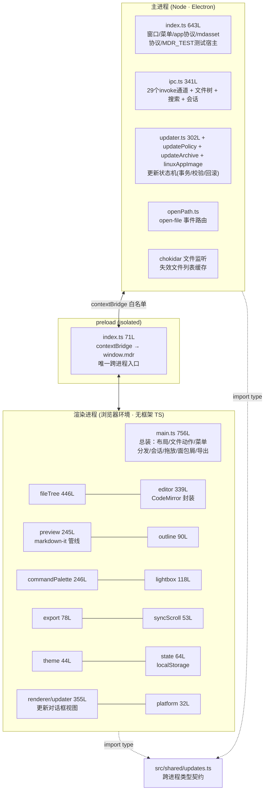
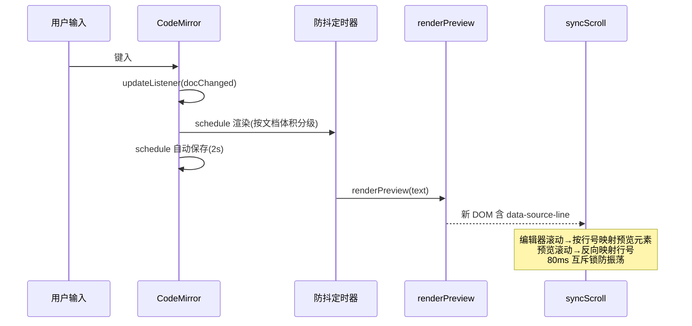

# Inkleaf 架构设计说明书 · 现状评审（调研第 3 轮）

> 日期：2026-10-14 · 范围：`src/` 全部 24 个 TS 模块（4,449 行）通读 + IPC 通道全量清点 + 构建链
> 目的：如实回答三个问题——当前架构是否优秀？规范是否达标？离"插件化宿主"差多少？
> 结论先行：**底盘（进程模型/安全/平台抽象）是优秀水准；上部结构（渲染层总装）是"单体能手"形态，插件化需要一次有计划的骨架手术，而非推倒重来。**

---

## 一、总体架构：三层进程模型

**评价**：进程边界是教科书式的——主进程持有全部 Node 能力（fs/watch/更新/协议），渲染层纯浏览器环境零 Node 依赖，preload 是唯一通道。`src/shared` 放跨进程类型（目前只有 UpdateState，规模尚小但方向正确）。

---

## 二、模块清单与依赖方向

| 模块 | 行数 | 职责 | 依赖方向（→ 被谁总装） |
|------|-----:|------|------------------------|
| renderer/main.ts | 756 | **总装/God 模块**：布局、开关文件、会话、菜单分发、面包屑、最近、拖放、导出、测试钩子 | 被 boot() 拉起一切 |
| main/index.ts | 643 | 窗口、菜单、双自定义协议、open-file、**MDR_TEST 测试宿主（约 370 行内联）** | Electron app |
| fileTree.ts | 446 | 树渲染、行内重命名/新建、拖拽移动、右键菜单、过滤 | main.ts |
| renderer/updater.ts | 355 | 更新对话框视图（纯视图，状态来自主进程） | main.ts (setupUpdater) |
| main/ipc.ts | 341 | 29 个 invoke 处理器、readTree（并行）、搜索、Dock 菜单、会话 | index.ts registerIpc |
| editor.ts | 339 | CodeMirror 封装、格式化命令、贴图、自动保存、任务回写 | main.ts |
| main/updater.ts | 302 | 更新状态机：下载/校验 sha256/事务文件/安装/回滚 | ipc.ts |
| commandPalette.ts | 246 | ⌘P/⇧⌘F 命令面板（模糊匹配+搜索分组） | main.ts |
| preview.ts | 245 | markdown-it 管线、KaTeX、Mermaid 懒加载+缓存、任务勾选、链接处理 | main.ts |
| lightbox/outline/export/syncScroll/theme/platform | 32–118 | 各自单一职责，边界清晰 | main.ts |
| state.ts | 64 | UiState + runtime 单例 | 几乎所有渲染模块 |

**依赖健康度**：叶子模块（lightbox/outline/syncScroll/theme）真正做到了单一职责、无横向依赖；`preview.ts` 只被 main.ts 调用、自身只依赖 theme——这是**渲染管线能被抽成"可插拔管线"的好底子**。

---

## 三、IPC 契约（全量 32 通道）

### invoke（renderer → main，29 个）

| 命名空间 | 通道 | 载荷 → 返回 | 备注 |
|----------|------|-------------|------|
| fs:* | read / write / writeBinary / rename / trash / mkdir / exists / copyImage | 路径(+内容) → 数据/结果 | 文件操作原子写（tmp+rename）✅ |
| lib:* | open / close / tree / listFiles | root → TreeNode[] | listFiles 有缓存，fs 事件失效 ✅ |
| dialog:* | openFolder / openFile / saveNewFile / pickImage / confirm | 选项 → 路径/布尔 | |
| search: | text | query → {path,line,text}[] | 上限 300 处 |
| session: | get / set | JSON 持久化 | main 侧还有 recentFiles 副本 |
| export: | savePath / pdf | html+target → 结果 | pdf 走隐藏窗口 printToPDF |
| win: | edited / file | 原生窗口态 | setDocumentEdited 等 |
| update: | check / download / install / cancel / getState | UpdateState | 主进程状态机驱动 |

### 推送（main → renderer，3 个）

| 通道 | 载荷 | 触发源 |
|------|------|--------|
| menu | action 字符串 | 菜单/Dock 菜单（`open-path:
` 复用该通道——约定式复用略 hacky） |
| open-path | 文件路径 | Finder 双击/Dock |
| fs:event / update:state | 变更事件 | chokidar / 更新状态机 |

**评审判断**：命名空间约定（fs:/lib:/dialog:）已是雏形；但**通道清单没有单一事实来源**——ipc.ts、preload、renderer 三处手工保持同步，改一处漏两处只会迟到不会缺席。**通道即公共 API，应有中心化契约文件 + 类型自动派生**（第 4 轮插件 IPC 的前置）。

---

## 四、渲染管线数据流

**评审判断**：
- 管线顺序合理（消毒在 DOM 写入前，Mermaid 例外已论证）；
- **致命短板：整条管线是 preview.ts 内的私有函数链**——`md` 实例、插件列表、后处理步骤全部硬编码。markdown-it 本身就是插件体系，我们却把它焊死了；
- `data-source-line` 行号注入是滚动同步的巧方案，应保留为公开契约；
- 缓存（Mermaid 60 条 + 文件列表）已就位，为将来的"渲染结果缓存/分块渲染"留了口子。

---

## 五、编辑 ⇄ 预览同步时序

**评审判断**：分级防抖 + 互斥锁是同类产品少见的认真做法；但同步器与两个面板实例**一对一硬绑定**——多标签页时代一个 syncScroll 要服务 N 对面板，需要改为按 Tab 注册。

---

## 六、状态管理现状（插件化的最大暗礁）

**问题**：同一事实存在多处副本（recent 在 localStorage、session.json、main.ts 会话对象三处；currentFile 在 runtime、editor、DOM 面包屑三处），靠**手工调用**保持一致（openFile 里连写 6 处）。单文档模式下勉强可控；**多标签页会让"每个 Tab 一套状态副本"直接爆炸**。结论：多标签之前必须先做集中式文档会话模型（`DocSession`），这是第 2 轮路线已排的顺序、本轮从代码层面确认了其必然性。

---

## 七、安全模型（现状优秀，需固化为插件规范）

| 层 | 机制 | 评价 |
|----|------|------|
| 进程 | contextIsolation:on / nodeIntegration:off / preload 白名单 | ✅ |
| 页面 | CSP（script-src 'self'，禁 inline） | ✅ |
| 资源 | `mdasset://` 协议限定书库根目录内 + MIME 白名单 | ✅ 插件资产加载可复用此模式 |
| 内容 | DOMPurify（Markdown HTML）/ Mermaid strict 模式 | ✅（例外已论证并记录） |
| 更新 | https 强制、sha256 校验、事务文件、回滚、URL 白名单 | ✅ 超出同类开源水准 |
| 待补 | 插件代码的加载/权限模型（目前不存在） | 第 4 轮核心命题 |

---

## 八、质量评审记分卡

| 维度 | 评分 | 依据 |
|------|:---:|------|
| 进程隔离与安全 | 9/10 | 见上表，唯一失分是开放了 `connect-src mdasset:` 的取捺 |
| 模块化（叶子层） | 8/10 | lightbox/outline/syncScroll/theme 等真正单一职责 |
| 总装层（main.ts） | 4/10 | 756 行 God 模块，菜单 switch、文件动作、导出、测试钩子全在一锅 |
| 代码规范 | 7/10 | TS strict 零错误、命名一致、注释克制；但 escapeHtml 三处重复、测试钩子混入生产路径 |
| 可测试性 | 7/10 | MDR_TEST 端到端链 + 445 行更新器单测 + 9 项断言；但渲染层模块无单测（DOM 强耦合） |
| 性能 | 8/10 | 分级防抖/Mermaid 缓存/并行树遍历/原子写 |
| 平台工程 | 8/10 | shared 类型、preload 平台注入、Linux 三形态 + CI（Windows 空缺是产品决策不是架构问题） |
| **可扩展性（插件就绪度）** | **3/10** | 无命令注册表、无面板注册表、渲染管线封闭、状态无中心、IPC 无契约文件——五缺 |

---

## 九、问题清单（编号定位，供第 4 轮逐项解决）

| # | 问题 | 位置 | 严重度 | 对插件化的阻碍 |
|---|------|------|:---:|----------------|
| A1 | 总装 God 模块 | renderer/main.ts 756L | 高 | 插件没有挂载点，一切功能仍会挤进总装 |
| A2 | 菜单/命令硬编码 | main/index.ts buildMenu + renderer switch-case | 高 | 插件无法贡献命令；改一处动三处 |
| A3 | 面板写死 | index.html 固定 DOM + applyLayout 逐一操作 | 高 | 插件无法注册侧栏/右栏面板 |
| A4 | 渲染管线封闭 | preview.ts 私有函数链 | 高 | 插件无法注入语法/块渲染器（markdown-it 白白闲置） |
| A5 | 状态多副本 | state.ts/session/实例内部 | 高 | 多标签与插件读写状态都会踩脏 |
| A6 | IPC 无契约中心 | ipc.ts↔preload↔renderer 三处手工 | 中 | 插件 API 无法类型安全地桥接 |
| A7 | 测试宿主混入生产 | main/index.ts 内联 MDR_TEST ~370 行 | 中 | 结构噪音，重构时是绊脚石 |
| A8 | 工具函数重复 | escapeHtml ×3 处 | 低 | 规范性 |
| A9 | 编辑器装配封闭 | editor.ts 扩展数组硬编码 | 中 | 插件无法贡献 CM 扩展（如双链补全需要） |
| A10 | open-path 复用 menu 通道 | Dock 菜单 `open-path:
` | 低 | 契约语义混用 |

---

## 十、给第 4 轮的输入（插件化设计必须回答的十个问题）

1. 命令注册表形态：menu 声明与 renderer 执行如何解耦？（解 A2）
2. 面板注册表：侧栏/右栏/底部区域的声明式注册与布局持久化如何共存？（解 A3）
3. 渲染管线钩子分级：markdown-it 插件 / 后处理 / 自定义语法块，三级钩子各给什么能力？（解 A4）
4. DocSession 集中状态：单 Tab 状态结构定义与多 Tab 容器的关系？（解 A5）
5. IPC 契约中心：单文件定义通道 + 类型派生 preload 的可行性？（解 A6）
6. 插件代码形态：进程内 ESM / Web Worker / 独立扩展进程，安全与能力的三角取舍？（承第七节安全模型）
7. 插件清单（manifest）字段与激活事件（VS Code contributes/activationEvents 的取舍）
8. 主题作为一等插件：CSS 变量命名空间与作用域隔离
9. 插件分发：本地目录 + Git URL 起步，是否需要签名/权限声明（结合现有更新器基础设施）
10. 内部功能先行插件化的迁移清单（狗粮路线，第 2 轮已定 3 个候选）

## 参考来源

- 本仓库源码通读：`src/main/*`（8 模块）、`src/preload/index.ts`、`src/renderer/src/*`（15 模块）、`src/shared/updates.ts`
- IPC 清点：`grep ipcMain.handle / ipcRenderer.invoke / webContents.send` 全量 32 通道
- 交叉引用：`docs/02-优化路线方案.md` §三（P0-1/P0-7 与 A 系列问题的对应）
- 背景参照（非本轮检索重点，架构判断源自源码事实）：Electron 安全清单、VS Code/Obsidian 扩展模型（第 4 轮将正式检索）
