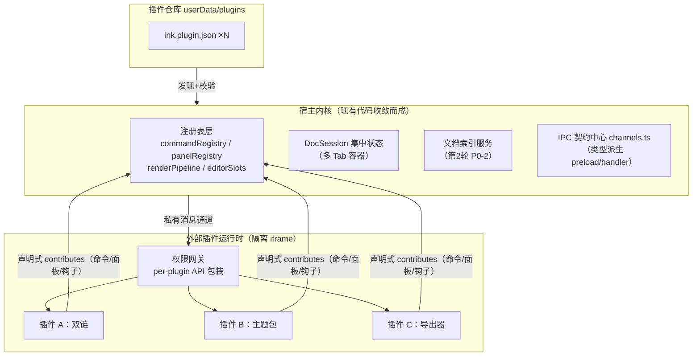
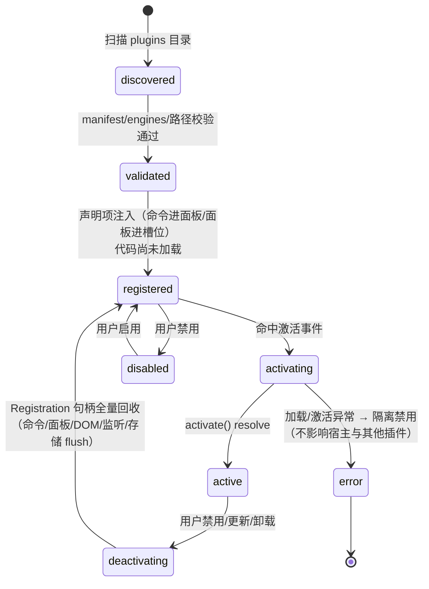
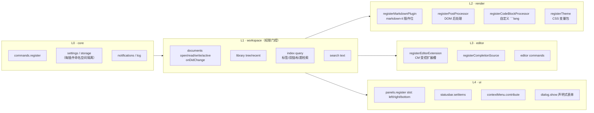
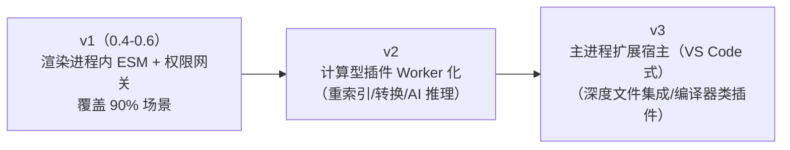
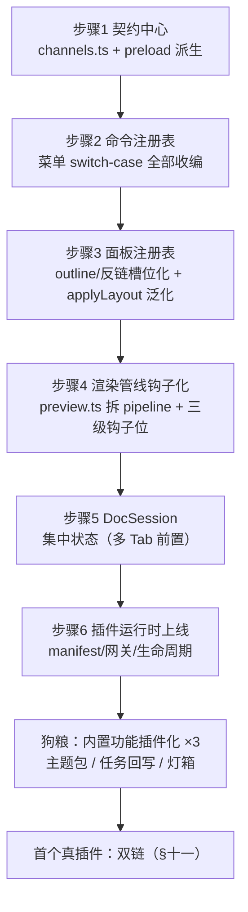

# Inkleaf 插件化架构设计（调研第 4 轮）

> 日期：2026-10-14 · 输入：`docs/03` 的 A1-A10 问题与十个待答问题、`docs/02` 的 P0-1 范围
> 调研基线：VS Code 扩展机制（manifest 声明式注入 + 独立扩展宿主 + 懒激活）、Obsidian 插件 API（register* 自动清理 + 三类渲染钩子）、Electron 沙箱实践（进程/iframe/能力门控三派）
> 核心主张：**Inkleaf 的未来功能应以插件形态生长——"产品功能即插件"（dogfooding），主程序收敛为宿主内核。**

> 2026-10-15 实现修正：外部插件采用不透明来源的 sandbox iframe 和私有消息通道，支持 `commands`、DOM 后处理和代码块处理器。外部插件不再导入宿主执行环境，也不能直接访问宿主 DOM、`window.mdr`、Node、MarkdownIt 实例或同步 `when` 函数。其余面板、文档和编辑器能力属于后续路线，本版尚未对外开放。

---

## 一、设计原则（从标杆提炼）

| 原则 | 出处 | Inkleaf 采纳方式 |
|------|------|------------------|
| manifest 声明先于代码激活：命令/面板未激活即可见可用 | VS Code | manifest 声明项由宿主渲染，激活按需懒加载 |
| 扩展宿主与 UI 环境隔离，RPC 通信 | VS Code | v1 不透明来源 iframe + 宿主消息权限网关；v3 演进独立宿主（§九） |
| register* 注册即自动清理，插件卸载无残留 | Obsidian | Registration 句柄集中管理，deactivate 自动回收 |
| 三类渲染钩子分层：inline 语法 / 后处理 / 代码块处理器 | Obsidian | 同款三级（§五），并落到 markdown-it 原生插件位 |
| 能力按需发放而非交出全量 ipcRenderer | Electron 安全实践 | 权限声明 + per-plugin 网关包装 |

**明确不做**（v1）：浏览器扩展兼容层（electron-chrome-extensions）、云插件市场、签名体系——留到有第三方生态诉求时。

---

## 二、目标架构总览



**v1 的实际隔离方式**：随应用分发的可信内置插件使用宿主 API；外部 ESM 只在 `sandbox="allow-scripts"`、无 `allow-same-origin` 的 iframe 中加载。宿主 CSP 不允许导入外部插件脚本。每个插件有私有 MessageChannel，宿主按绑定的插件记录检查权限、命令命名空间及生命周期，不接受消息自称的插件身份。外部渲染处理器接收序列化上下文和独立 DOM 副本，返回内容经清理后应用，保留原文中已有的安全样式和资源地址。JavaScript 函数和宿主对象不跨隔离边界传递；不能安全实现的同步 API 会明确拒绝。

---

## 三、插件清单 ink.plugin.json（manifest）

```jsonc
{
  "id": "ink.wikilink",              // 反向域名式，全局唯一
  "name": "双链",
  "version": "0.1.0",                // semver
  "author": "wangyuan",
  "description": "[[双链]]、悬停预览、反向链接面板",
  "engines": { "inkleaf": ">=0.4.0 <0.5.0" },   // 兼容窗，宿主 API 主版本锁
  "main": "main.mjs",                // ESM 入口，export async function activate(ink), deactivate()
  "activation": [                    // 懒激活事件
    "onStartupFinished",             // 启动完成后（重插件避免用它）
    "onCommand:wikilink.toggle",     // 命令首次调用时（推荐）
    "onFileType:md,markdown",        // 特定类型文档打开时
    "onIndexReady",                  // 书库索引就绪（索引类插件）
    "onView:backlink-panel"          // 面板首次展开时
  ],
  "contributes": {                   // 声明式注入——未激活即可见
    "commands": [
      { "id": "wikilink.toggle", "title": "切换双链高亮", "key": "CmdOrCtrl+Alt+W" }
    ],
    "panels": [
      { "id": "backlink-panel", "title": "反向链接", "slot": "right" }
    ],
    "settings": [
      { "key": "wikilink.style", "type": "string", "default": "underline" }
    ]
  },
  "permissions": [                   // 未声明即无此能力，安装时展示给用户确认
    "index:query",
    "documents:write",
    "ui:panel"
  ]
}
```

校验规则：id/version/engines 必填；`main` 必须位于插件目录内（路径穿越拒绝）；命令 id 必须以插件 id 前缀开头（防碰撞）；permissions 超集声明直接拒载并提示。

---

## 四、生命周期状态机



要点：① `registered ≠ active`——声明式贡献不付运行时代价（VS Code 命令面板秒开的秘诀）；② 激活失败**故障隔离**，宿主继续运行并在插件管理页显示原因；③ 卸载清理走 Registration 回收器：`ink.onDispose(fn)` / 每个 register* 返回句柄 `dispose()`，DOM 面板内容随容器销毁。

---

## 五、API 分层设计（window.ink）



分层规则：**只能向下依赖，不能横向**；L1 以上全部经权限网关（per-plugin 包装，未声明权限的方法调用直接 throw `PermissionDenied` 并记录）；`fs` 不直接暴露——文件读写只经 `documents:*` 作用域到"当前书库 + 插件数据目录"，任意路径 IO 不进 v1 API 面（需要时走主进程白名单扩展）。

**渲染钩子与现有管线对应关系**（解 A4）：

```mermaid
flowchart LR
    A[文本] --> B["markdown-it 实例"]
    B --> B1["插件位 R1：wikilink inline 规则<br/>/ footnote / callout"]
    B1 --> C[DOMPurify]
    C --> D["宿主后处理（图片/复选框）"]
    D --> D1["插件位 R2：悬停卡/灯箱增强"]
    D1 --> E["```lang 代码块<br/>插件位 R3：图表/公式/自定义渲染"]
    E --> F[大纲/滚动同步]
```

**编辑器扩展槽**（解 A9）：宿主在 EditorPane 暴露受控 `Compartment` 数组——插件可注册 `ViewPlugin`/`CompletionSource`/`keymap`，但 state facet 白名单开放（补全、装饰、悬停），不暴露完整 EditorView 引用，防止越权操作非活动文档。

---

## 六、IPC 契约中心与命令注册表（解 A2/A6）

- **channels.ts 单一事实源**：通道名 + 请求/响应类型 + 权限标记集中定义，`ipc.ts` handler 与 `preload` 方法由它类型派生；插件新增能力走 `ink:*` 命名空间（`ink:invoke:{pluginId}`），载荷带 per-plugin token，主进程网关二次校验权限——插件永不触达裸通道。
- **命令注册表**：菜单构建改为遍历 `commandRegistry`（内置命令与插件命令同源）；快捷键冲突由注册表仲裁（先注册者优先 + 用户可改）；`open-path:<p>` 这类约定式复用清理为正式通道（解 A10）。

---

## 七、状态与存储（解 A5）

- 宿主侧：`DocSession`（path、EditorState、预览缓存、scrollTop、dirty）集中管理，多 Tab = DocSession 集合 + activeSessionId；所有面板订阅 session 变化而非各自持副本。
- 插件侧：`ink.storage`（kv，写 `~/.inkleaf/plugin-data/{id}/`）、`ink.setting(key)`（用户可改的设置项，进宿主设置 UI）。禁止插件写宿主 localStorage（命名空间冲突+不可迁移）。

---

## 八、开发者体验与分发

| 环节 | 设计 |
|------|------|
| 脚手架 | `npm create ink-plugin`（模板含 manifest/main.mjs/类型包 `@inkleaf/plugin-api`——纯类型，零运行时依赖） |
| 开发调试 | dev 模式加载任意本地目录；宿主内置"插件开发面板"：日志、激活状态、重载按钮（保存即热重载单插件） |
| 安装分发 v1 | ① 本地目录放入即装；② Git URL 安装：拉取 zip（https 强制）→ manifest 校验 → 权限确认对话框 → 落盘；复用更新器的 sha256/事务/回滚基建做插件更新检查 |
| 版本策略 | 插件 semver + `engines.inkleaf` 兼容窗；宿主 API 变更走 deprecation：旧窗内保留兼容垫片一个次版本周期 |
| 主题包 | 纯 CSS 变量包 + preview.json（无须 JS main），作为"最低门槛插件"培养生态冷启动 |

---

## 九、演进路线（三级运行形态）



API 全消息化的设计保证三级形态间插件**无需重写**；v2/v3 只在"确实出现该类插件"时启动（需求牵引，不为架构而架构）。

---

## 十、从单体到插件宿主的迁移路径（解 A1，衔接 docs/02 阶段一）



每步保持全量回归链绿色（50+ 截图 + 9 项断言是安全网）；步骤 1-5 即 docs/03 问题 A1-A6 的逐项消解。

---

## 十一、示例插件完整设计：双链（ink.wikilink）

以 P0 产品需求做"架构压力测试"，一个插件贯穿全部 API 层：

| 层 | 用法 | 对应 API |
|----|------|----------|
| manifest | `activation: [onFileType:md, onIndexReady]`；`permissions: [index:query, documents:write, ui:panel]` | §三 |
| 渲染 | markdown-it inline 规则解析 `[[目标\|显示]]`、`[[目标#锚点]]` → 内链 span（断链灰显）；post-processor 挂悬停预览卡 | R1 + R2 |
| 编辑器 | 输入 `[[` 触发补全（索引标题检索，最近使用排序）；LinkMark 装饰 | E1 + E2 |
| 索引 | 启动时注册"出链扫描器"进索引服务（正则提取 `[[..]]`）；反链 = 出链倒查 | W3 |
| 面板 | 右栏"反向链接"面板：引用者 + 上下文片段 + 未链接提及 | U1 |
| 命令 | `wikilink.copy-ref`（复制当前页引用格式）、`wikilink.toggle` | C1 |
| 设置 | `wikilink.style: underline | brackets | none` | C2 |

**这个示例验证了关键主张**：第 2 轮的 P0-2/3/6（双链三件套）可以完全以插件形态交付——索引服务与 DocSession 是宿主职责，语法/补全/面板是插件职责，边界清晰。

---

## 十二、对第三轮十个问题的回答索引

| # | 问题 | 本文位置 |
|---|------|----------|
| 1 | 命令注册表形态 | §六 |
| 2 | 面板注册表与布局共存 | §五 L4 + 迁移步骤 3 |
| 3 | 渲染钩子三级能力 | §五 |
| 4 | DocSession 与多 Tab | §七 + 迁移步骤 5 |
| 5 | IPC 契约中心 | §六 |
| 6 | 插件代码形态与安全三角 | §二 + §九 |
| 7 | manifest 与激活事件 | §三 |
| 8 | 主题作为一等插件 | §八 |
| 9 | 分发与校验 | §八 |
| 10 | 狗粮迁移清单 | §十 |

## 参考来源

- [VS Code Extension Anatomy](https://code.visualstudio.com/api/get-started/extension-anatomy) · [Contribution Points](https://code.visualstudio.com/api/references/contribution-points) · [Activation Events](https://code.visualstudio.com/api/references/activation-events) · [VS Code 沙箱迁移（扩展宿主进程模式）](https://code.visualstudio.com/blogs/2022/11/28/vscode-sandbox)
- [Obsidian Plugin 类（onload/register* 生命周期）](https://docs.obsidian.md/Reference/TypeScript+API/Plugin) · [Manifest 规范](https://docs.obsidian.md/Reference/Manifest) · [Markdown 后处理](https://docs.obsidian.md/Plugins/Editor/Markdown+post+processing) · [Editor extensions](https://docs.obsidian.md/Plugins/Editor/Editor+extensions)
- [Electron 安全指南](https://electronjs.org/docs/latest/tutorial/security) · [沙箱 iframe 的 allow-scripts+allow-same-origin 陷阱](https://discourse.mozilla.org/t/can-someone-explain-the-issue-behind-the-rule-sandboxed-iframes-with-attributes-allow-scripts-and-allow-same-origin-are-not-allowed-for-security-reasons/110651) · [sandboxed iframe 安全通告](https://github.com/electron/electron/security/advisories/GHSA-9f4c-93c8-jc8g)
- 内部输入：`docs/02-优化路线方案.md`（P0-1 范围/索引服务）、`docs/03-架构设计说明书-现状.md`（A1-A10/十个问题）
