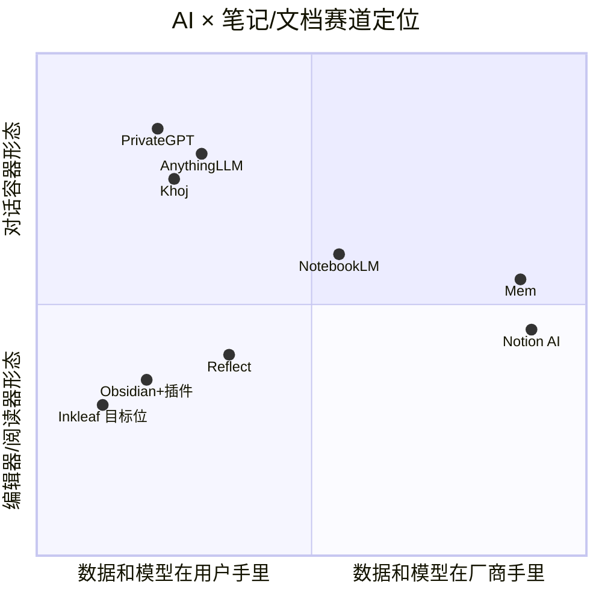
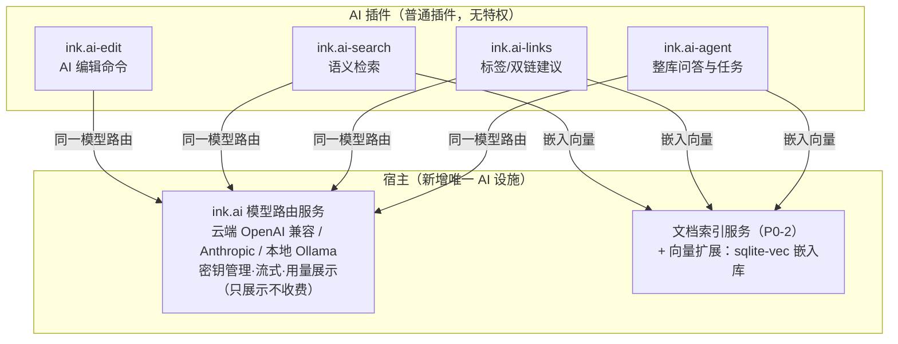
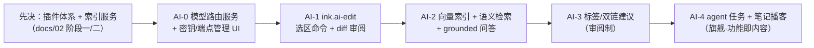

# Inkleaf AI 时代竞争力战略（调研第 5 轮 · 五轮收官）

> 日期：2026-10-14 · 素材：用户研究库 24 篇深度报告（六大型谱/七个横切模式）+ 3 组赛道检索（本地优先 RAG、主流 AI 笔记、Obsidian AI 插件生态）
> 要回答的问题：AI 时代，一个本地优先的 Markdown 阅读器凭什么有竞争力？接入模型之后到底做什么？

---

## 一、结论先行

1. **赛道已经拥挤，但拥挤在"对话容器"和"云全家桶"两个象限**：AnythingLLM/Khoj/PrivateGPT 是"跟你的文件聊天"的容器，Notion AI/Mem 是"数据在云端、AI 全自动"的工作台。**"数据在用户手里、模型在用户手里、计价在用户手里"的安静阅读器，位置是空的。**
2. **AI 对 Inkleaf 是"能力"不是"界面"**：不做 AI-first 的全自动组织（Mem 路线，重、黑盒、与"安静"气质相反）；AI 以第 4 轮插件体系的一等公民接入——宿主只提供"模型路由服务"，一切 AI 功能是插件。
3. **BYO-key（自带密钥）+ 本地 Ollama 双通道是结构性优势而非妥协**：研究库"计价三波翻车"定律（Cursor/v0/Bolt 的 per-seat→credits→按结果每一步都在烧信任）——**我们不经手 token，就永远不会栽在计价上**；Reflect 已验证 BYO-key 是隐私人群的付费理由。
4. **最高传播杠杆是 NotebookLM 式"功能即内容"**（Audio Overview 让每个用户成为产品演示者）——"把我的笔记读给我听/生成播客分享"应作为远期旗舰，而非又一个聊天框。
5. **优先级**：L1 AI 编辑命令（选区改写/翻译/摘要，Cursor 式 diff 审阅）> L2 书库语义检索（RAG over vault）> L3 知识增强（标签/双链建议，审阅制）> L4 Agent 与多模态产出。每级都独立可用、可单独取舍。

---

## 二、赛道全景（2026）



| 玩家 | 一句话 | 对我们的启示 |
|------|--------|--------------|
| Notion AI | 云全家桶 + agents + 跨应用搜索 | 数据占有是其模式前提——正是我们不做的 |
| Mem | AI-first 自动组织（自动标签/关联/问答） | 全自动黑盒的信任问题：用户无法审阅"AI 为什么这么归" |
| NotebookLM | 严格锁进用户资料 + 内联引用 + Audio Overview | **"最受限的模型也赢"**；grounded 引用是信任 UI 的范本 |
| Reflect | 快速个人笔记 + BYO-key 隐私助手 | BYO-key 先例：隐私人群接受自带密钥换控制权 |
| AnythingLLM/Khoj/PrivateGPT | 本地 RAG 容器（PDF/文档问答） | 验证了本地推理需求，但**不是编辑器**——写作/阅读/排版体验缺位 |
| Obsidian Copilot / Smart Connections | 插件层 AI：BYO-key 聊天 agent / 本地嵌入找相关笔记 | **最直接的对标**：证明"编辑器 + 插件层 AI"路径成立（Smart Connections 零配置本地嵌入是亮点） |

**空位判断**：左上象限（用户主权 × 编辑器形态）只有"Obsidian+插件"一个成熟玩家，且它 AI 是社区拼装而非一等设计、中文体验欠佳。Inkleaf 的目标位 = **Obsidian 的本地主权 × Reflect 的 BYO 优雅 × NotebookLM 的 grounded 信任 × 中文原生**。

---

## 三、研究库六条定律 → Inkleaf 的 AI 策略含义

| 定律（出自研究库） | 对 Inkleaf 的含义 |
|--------------------|-------------------|
| ① Cursor：Agent 编辑是补全的 40 倍——"指挥"取代"打字" | AI 交互以**命令 + diff 审阅**为中心，不做续写式 autocomplete（编辑器场景收益低、干扰"安静"） |
| ② NotebookLM：最受限的模型也赢（锁进资料换信任） | 书库问答**必须 grounded + 内联引用**（点引用跳转到我的文档），拒绝无出处的自由生成 |
| ③ 计价三波迁移与集体翻车（失败重试收费=信任红线） | BYO-key 架构让我们**结构性免疫**：不经手 token 就没有计价叙事，永远不碰这条红线 |
| ④ 平台回收定律（应用层验证→平台内建） | 本地文件 + 插件生态是抗回收的护城河：数据在用户手里，平台无从回收 |
| ⑤ 融资结构决定产品节奏（Midjourney 零融资→慢发布→品味品牌） | 个人项目 = 零融资物种：**慢即是快**，每一步保持回归链绿色，品牌靠品味积累 |
| ⑥ llama.cpp：先选部署面再选技术栈（推理回到笔记本） | 模型路由层从第一天就同时支持云端 API 与本地 Ollama，让用户选择部署面 |

---

## 四、定位主张与竞争壁垒

**一句话**：给把笔记当资产的人的安静阅读器——文件是你的，模型是你的，选择权是你的。

**三乘积壁垒**（单项都可被模仿，乘积难被复制）：

```mermaid
flowchart LR
    A["本地优先<br/>（文件主权·抗平台回收）"] × B["插件生态<br/>（AI 是插件不是绑架）"] × C["中文体验<br/>（排版/输入/审美原生）"]
    D -->|"="| E["Inkleaf 的差异化位置"]
    A & B & C --> D{"三乘积"}
```

---

## 五、AI 能力提案（L1→L4，逐级独立可用）

### 架构总览：AI 是插件体系的一等公民



**关键决策：模型路由是宿主服务，AI 功能全是普通插件**——路由解决"密钥/端点/流式"这类所有 AI 插件共用的地基（含权限模型 `ai:invoke`），功能插件互不绑架：用户可以只要"翻译选区"而不要"整库问答"。

### L1 · AI 编辑命令（优先级最高 · 量级 M）

- **场景**：选中文字 → ⌘K AI 面板：改写/扩写/缩写/中英互译/改语气/自定义 prompt 模板；光标处"继续写"。
- **形态**：结果以 **Cursor 式 diff 审阅**呈现（接受/拒绝/重新生成），绝不全自动改写——采用率的关键（定律①）。
- **技术**：宿主流式网关 + CM 合并视图（CodeMirror 自带变更合并能力）；设置里逐命令配置模型。

### L2 · 书库语义检索（优先级高 · 量级 M-L）

- **场景**：⇧⌘F 新增"语义"开关（"找讲类似想法的笔记"自然语言查询）；右栏"相关笔记"（Smart Connections 式）；问答 grounded 模式：回答 + **内联引用点击跳转原文**（定律②）。
- **技术**：索引服务扩展——嵌入模型可插拔（本地 transformers.js/Ollama embeddings 优先，云端可选）；向量存 sqlite-vec（单文件、零服务、与本地优先气质一致）；增量嵌入挂现有 chokidar 事件。

### L3 · 知识增强（优先级中 · 量级 M）

- **场景**：写作停顿后右栏出现"建议标签/建议双链"（审阅制，一键采纳/忽略，**绝不静默写入**）；每日笔记的"昨日摘要"；写作目标统计。
- **判断依据**：Mem 的全自动组织不可审阅是其信任软肋；我们反其道——AI 只建议，笔在用户手里。

### L4 · Agent 与多模态产出（远期旗舰 · 量级 L）

- **场景**：① 整库 agent 任务（"把 2024 年的旅行笔记整理成目录索引页"——产出仍是审阅制 diff）；② **"读给我听/笔记播客"**（NotebookLM Audio Overview 的本地版：TTS 流水线 + 可分享音频文件）——**功能即内容**，每个分享都是产品演示（研究库 NotebookLM 报告的增长结构）；③ 大纲→文档的多模态产出。
- **定位**：这是"出圈"功能，放在插件体系与 L2 索引成熟之后。

---

## 六、克制清单（不做什么，与做什么同等重要）

1. **不做订阅计价、不代购 token**——BYO-key 是原则不是过渡（结构性避开定律③）。
2. **不做云同步与云端默认**——文件夹即同步；模型同理，本地 Ollama 是一等选项不是二等公民。
3. **不做不经审阅的自动写入**——所有 AI 产出走 diff/建议两态（信任原则）。
4. **不做后台静默全库扫描**——嵌入索引的构建/范围/删除完全用户可见可控（对照 Immich 的隐私叙事）。
5. **不做 AI-first 全自动组织**——不追 Mem 路线；"安静"是产品人格，AI 是客人。
6. **不在内核塞 AI**——模型路由之外，AI 一律插件形态（防内核膨胀，保架构纯净）。

---

## 七、分阶段路线（衔接 docs/02 阶段三）



每级验收锚点：AI-1（一次改写的接受率与延迟体感）、AI-2（语义查询 top5 命中率 + 引用点击跳转闭环）、AI-3（建议采纳率 > 30% 才算及格）、AI-4（生成的音频有人主动分享）。

---

## 八、给实施计划的输入（五轮收官）

- 本文档 L1/L2 对应 docs/02 阶段三的 AI 占位，落地顺序不早于插件内核与索引服务；
- 模型路由服务的 IPC 契约（`ai:*` 命名空间）应并入 docs/04 §六 的 channels.ts 首批清单；
- 中文体验是三乘积壁垒之一——AI 命令的中文 prompt 模板质量（改写/语气）应作为产品级资产维护，不是字符串常量。

## 参考来源

**用户研究库**（/Users/wangyuan/Desktop/MyCoach/ai-software-research/projects）：`00-总览-idea模式分析.md`（六大型谱/七个横切模式）、`23-notebooklm.md`（受限模型/功能即内容）、`01-cursor.md`（Agent 编辑 40 倍）、`28-llama-cpp.md`（先选部署面）、`33-immich.md`（本地主权叙事）、`19-windsurf.md`/`26-gamma.md`（计价与资本结构案例）

**网络调研**：[2026 本地 AI 笔记横评](https://ariv.one/compare/best-local-ai-note-taking-apps) · [内置 RAG 应用排名](https://www.promptquorum.com/power-local-llm/local-ai-app-with-built-in-rag) · [本地搜索/RAG 目录](https://www.localalternative.io/categories/search-rag) · [自托管 RAG 指南](https://onyx.app/insights/self-hosted-rag) · [AnythingLLM](https://anythingllm.com) · [12 Best AI Note Apps 2026](https://storyflow.so/blog/best-ai-note-taking-apps-2026) · [Notion AI 官网](https://www.notion.com/product/ai) · [Reflect（BYO key）](https://reflect.app) · [Smart Connections](https://github.com/brianpetro/obsidian-smart-connections) · [Obsidian Copilot](https://obsidiancopilot.com/en)
