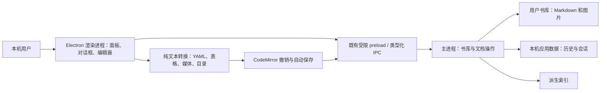
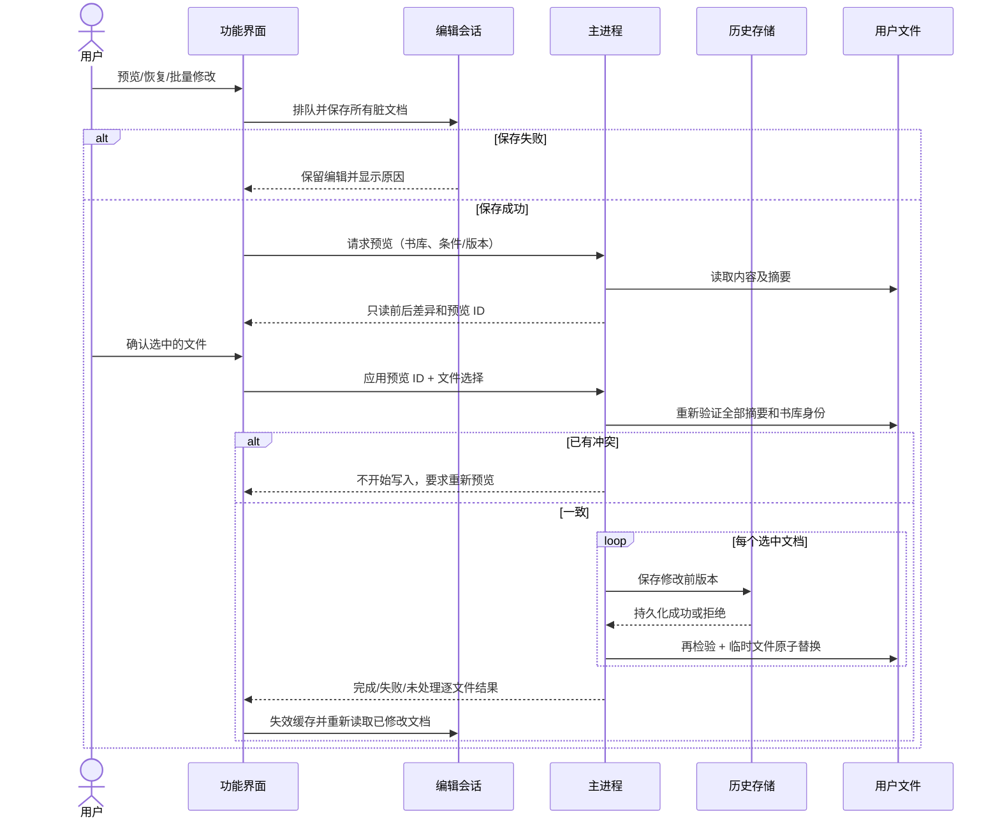
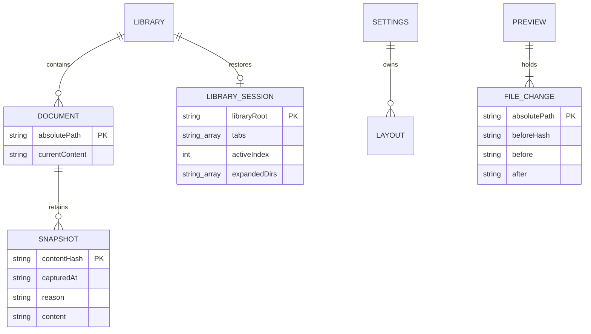
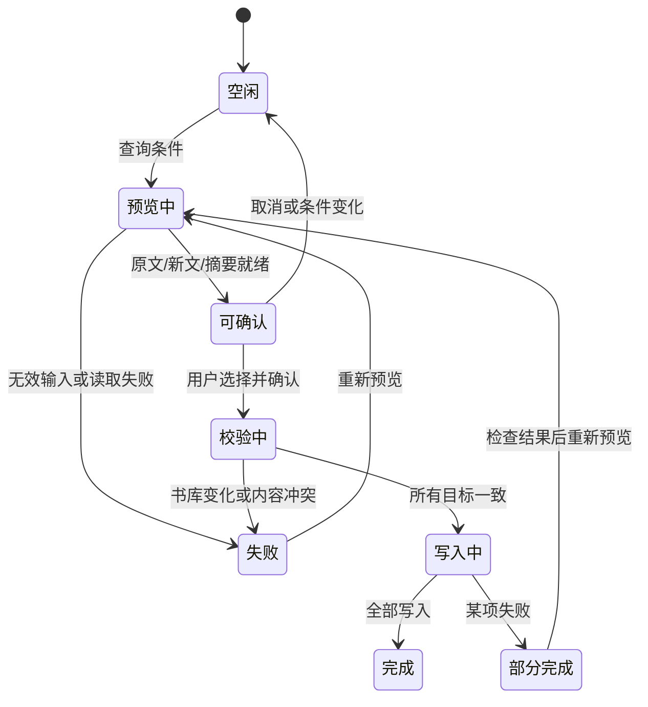

# 创作与知识管理技术设计

版本：1.1；状态：DELEGATED_TECHNICAL / READY_FOR_IMPLEMENTATION。
深度：DETAILED，因涉及文档恢复、跨文件修改、并发冲突与旧会话兼容。
依据：08 需求 v1.0；用户明确答复“按方案完成，技术细节你定（推荐）”。模块、数据结构、依赖、UI、测试均在授权内；没有新增产品范围。此状态为受委托的技术决策，不代表用户逐行审批技术文档。

## 系统边界与结构

箭头为依赖/调用，不表示数据上传；没有新增服务或网络端点。外部插件仍走已有隔离 iframe，不开放新文件 API。

## 主要流程及失败分支

批量预览由主进程保管原文与新文，renderer 不能伪造目标内容。预览在条件变化、书库切换或使用后失效；逐文件写入失败立即停止。不能提供跨多个普通文件的原子事务，依需求明确报告部分成功并用历史恢复，不覆盖外部内容做自动回滚。

## 模块接口设计（拟新增模块；既有路径已检查）

| 模块/入口 | 输入 → 输出 | 所有权、协作及错误 |
|---|---|---|
| `src/main/document-history.ts` 的 DocumentHistory | list(path)、capture(path, reason)、restore(path,id,expected)、write(path,text,expected?)、setLimit(number) | 文件级串行队列；历史目录和配置仅主进程写。写入前持久化旧内容，失败则不替换原文；list 捕获当前磁盘内容，保证最新版本可见。 |
| `src/main/knowledge-service.ts` | search(root, options) → hits；preview(root, mutation) → preview；apply(root,id,paths) → result；create(root,relative,text) → path | 所有新增跨文件访问按真实路径约束当前书库；预览用内容摘要检测变化；创建使用排他写，不覆盖现有文件。实际文件写入委托历史模块。 |
| `src/shared/markdown-tools.ts` | read/updateProperties(raw)、renameTags(raw,old,new)、tableEdit(raw,selection,op)、mediaEdit(raw,selection,fields)、expandTemplate(text,values) | 纯变换，返回修改文本/选择范围或明确错误。保持正文与换行，复杂 YAML 保留；不执行 YAML/模板代码。 |
| `src/shared/knowledge.ts` | 类型：HistoryEntry、SearchOptions、MutationPreview、BatchResult、PropertyField | IPC 请求和响应的单一类型来源；不向外部插件增加权限。 |
| `src/renderer/src/documentTools.ts` | 接收编辑器、文件/书库 getter、受保护修改回调；注册工具栏和命令入口 | 历史、属性、搜索与写作对话框；响应按请求代数和当前路径检查，避免旧响应覆盖新文档。异步操作加锁，错误不清空输入。 |
| `src/renderer/src/workspaces.ts` | librarySnapshot(root)、remember/forgetLibrary、save/apply/removeLayout | 维护书库 UI 会话和命名布局；当前库启动仍复用 session.json；每库快照与命名布局放现有 Electron profile 的独立 localStorage 命名空间，不修改旧字段。 |
| `src/main/document-index.ts` | backlinks(targetPath)、mentions(targetPath)、tags/tree、filesByTag(prefix) | 接收明确目标路径；返回上下文文本和行号。索引是可重建投影，更新后不等待磁盘缓存才能展示。 |
| `src/renderer/src/wikilink.ts` 与 backlink.ts | 双链目标/源文档 → 导航或创建；当前路径 → 引用/未链接提及 | 解析可传来源路径；书库相对目录与绝对目标路径区分；越界不创建，旧异步响应丢弃。 |
| 预览 Markdown 扩展 | tokens → 标题锚点、TOC、图片尺寸 | 目录与既有标题锚点共用结果；尺寸为正整数像素，Markdown 形式 `{width=320 height=200}`，不允许任意 CSS；导出沿用真实预览 DOM。 |

内部结构以薄适配器连接既有编辑/导航流程，不重写整个 main.ts。界面通用弹窗抽取到 `src/renderer/src/toolDialog.ts`；只抽取本轮所需的焦点、busy 和错误显示。

## 数据与状态

历史使用路径摘要命名 JSON 文件，记录保存原始路径以校验身份，JSON 原子落盘、权限 0600。内容摘要去重；默认保留 100 个不同内容版本，可调整为 2–10000 的整数（至少保留当前与前一版）。降低上限只在明确确认设置后按最新顺序裁剪；读取历史文件损坏时拒绝覆盖，不将损坏当空记录。

新格式带 version；不删除旧 session 字段或旧 UI 设置。模板、每日笔记设置和命名布局放独立命名空间；模板按本机保存，调用时绑定当前书库创建文件，不保留跨书库文档引用。文档路径变更时迁移关联历史；旧版本不会读取新增记录，但仍能打开标准 Markdown 正文。

## 不变量和兼容

1. 编辑器修改进入 CodeMirror 撤销链；整文替换也通过 transaction，不用 openFile 丢弃撤销。
2. 恢复和批量修改先保存脏文档，冻结修改入口，失效并刷新受影响标签缓存，避免自动保存把旧内容写回。
3. 每次文件替换前重新比较预期内容；同一进程的写、恢复和批量写共用队列。普通文件系统无法杜绝其他进程在最后一次比较与 rename 间的极短竞态；保留旧快照，不宣称系统级锁。
4. YAML 选用保留注释的安全文档解析器；重复键、解析错误或执行型头部拒绝编辑。未知复杂节点保持原文；字段类型受面板明确选择。
5. 搜索默认与旧全文模式一致；旧 searchText(query, regex) 保留，新增高级搜索独立类型化入口。正则在有超时的工作任务运行，避免恶意模式阻塞 Electron 主进程。
6. 标签/提及识别排除代码、链接目标和 URL。标签树仅为投影，原标签格式保持。重复名称反链使用目标路径匹配。
7. 保存/恢复 CRLF 文档时保留其换行风格；目录锚点与重复标题使用同一规则。
8. 新写入拒绝书库外真实路径。导出 HTML 仍可使用用户选择的目标路径，历史仅处理 Markdown，不改变导出授权边界。

## 验证设计（FEATURE + recovery）

状态：VERIFICATION_DESIGN_READY。全为确定性产品功能，无模型生成评估。每个 FR 的 AC 沿用需求表，不再复制含义。

| 证明组 | FR 覆盖 | 主要风险与 oracle | 最低充分证据 |
|---|---|---|---|
| V-H | H1–H3 | 写入失败损失原文、恢复冲突、重启丢版本、裁剪错误 | 临时真实文件 + 实际历史模块的内容断言、注入文件写失败；IPC 到 UI 恢复并再次恢复；旧记录重开 |
| V-P | P1–P3 | YAML 字段/注释/正文丢失 | 解析前后字段值 + 非编辑片段/CRLF 精确比较；非法头部拒绝；真实编辑器面板与撤销 |
| V-S | S1–S4 | 错误匹配、未选中文档被改、并发覆盖、无限正则 | 小型期望结果集；真实磁盘预览→冲突→重试→部分失败→历史恢复；超时负例；UI 选择与取消 |
| V-W | W1–W3 | 旧会话损坏、书库串状态、未保存内容丢失 | 原有文档会话测试 + A/B 书库重启往返与布局 CRUD；保存失败阻止切换 |
| V-K | K1–K5 | 标签误改代码/URL、反链误连同名文档、创建越界 | 含代码、中文、嵌套标签的 golden 文档 + 临时书库和符号链接；真实 UI 展开/跳转/创建 |
| V-E | E1–E5 | 新建覆盖旧文、表格误拆、媒体或目录导出损坏 | 文本转换独立断言、真实文件重复创建、真实 Chromium 预览/HTML 导出/撤销 |

场景数据：仅临时测试书库和测试配置。既有 `test:regressions`、`test:doc-session-ui`、`test:plugin-dom-ui`、`test:bug-tickets-ui`、`test:ui` 保持；新增 `test:knowledge-ui` 串联六组真实界面与真实 owned IPC/磁盘，Electron 的选文件和系统确认可替换为明确的测试选择。不得模拟被测历史/转换/搜索服务为成功。

门槛：切片先最小真实 RED，再模块/受影响回归；整个功能交付前类型检查、全单测、知识工具 UI、文档会话、插件、书库/图片、全应用 UI。macOS 本机；Linux x64/ARM64 CI 结果单列，未跑不得写通过。版本更新、提交与 dev 推送后验证远程 SHA；不在本轮发布正式安装包。

## 技术决策与一致性复核

- 原子 JSON 与文件级队列优先于新数据库：便于独立故障测试，不新增原生依赖；用户文档本身仍是权威数据。
- 主进程保存批量预览优先于 renderer 提交任意新内容：预期原文、路径、选中范围由同一服务校验。
- 保留注释的 YAML 文档树优先于完整 stringify：兑现未编辑字段/注释保留。
- 视图覆盖：系统/信任边界、端到端调用/错误返回、模块接口、持久实体与批量状态机均已对应上述验证组。无云部署视图，因为没有新服务。
- 自查结论：所有 FR 均有负责模块和验证组；依赖无环；没有未决产品含义。常规技术方案根据明确委托通过设计检查。后续发现契约冲突须先记录影响，不静默改需求。

## v1.1 技术校准（DELEGATED_TECHNICAL）

CR-KNOW-01 的 PLAN/FLOW_BACK 分析保持全部用户需求不变：工作区快照、模板、每日设置属于 UI profile，使用 `inkleaf.workspaces.v1` / `inkleaf.writing.v1`；当前库 session.json 仍负责旧会话兼容。没有已发布的新数据需要迁移。此前设计“复用 session”的表述过宽，现按实现明确两个持久化职责。默认设置不写入用户书库，读取损坏拒绝操作。历史存储为一个文档一个摘要文件，范围限制明确。

批量条件输入改变时移除旧预览；主进程预览带 epoch/有效期，最多保留 3 份。搜索资源边界：单篇 8 MB、总范围 64 MB、正则 1.5 秒、最多显示 1000 条命中；替换会完整计数与生成差异，超限报错而非截断写入。
