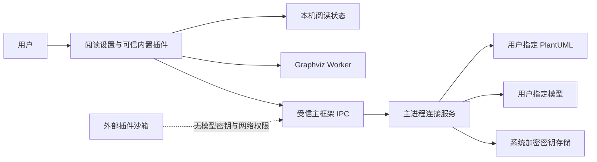
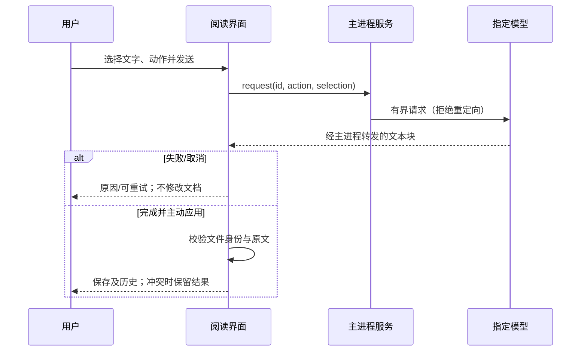
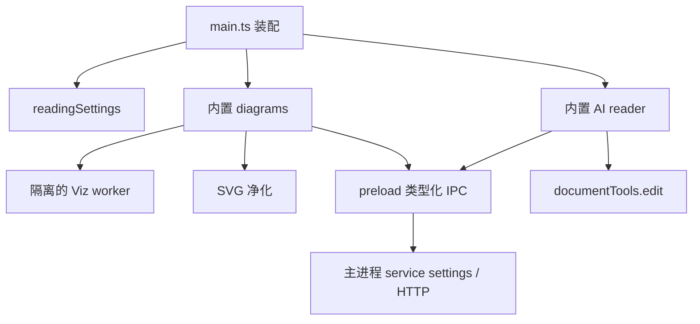
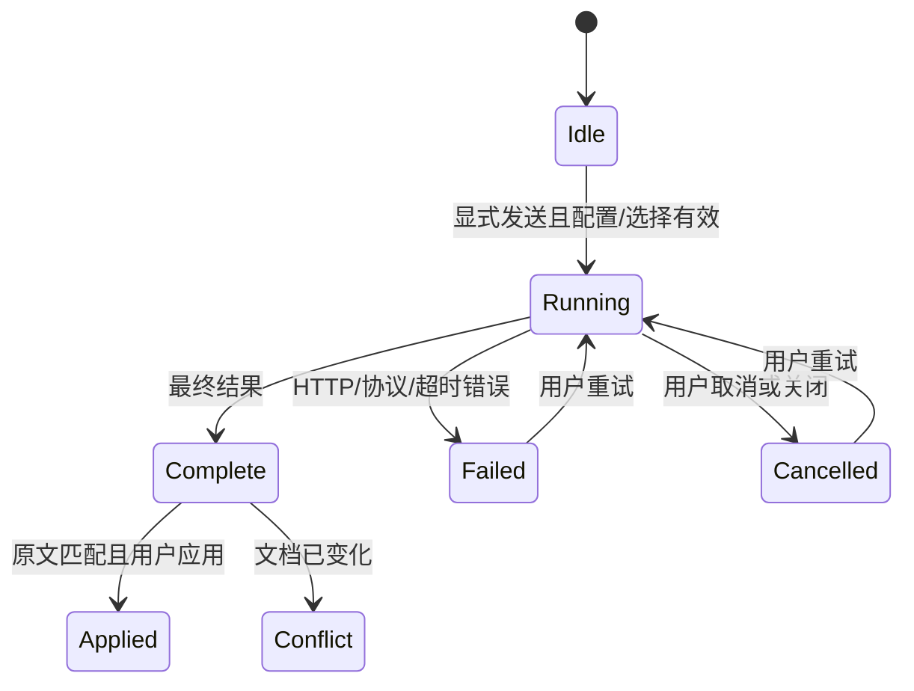

# 0.5.3 设计与实施 v1.0

状态：DELEGATED_TECHNICAL。依据：用户明确“技术细节由我确定”并确认范围。深度 STANDARD；网络、密钥和异步应用需要接口/状态设计。需求来源：14-0.5.3需求.md。此文为技术委托下的设计，非人工逐字审批。

## 设计
阅读设置沿用本机 UiState；默认 1000px、左右 24px，可选 640–1600px、12–64px 和铺满；CSS 变量仅作用正文面板。旧状态增加默认值，无破坏性迁移。
图表渲染异步填入，不阻塞文档打开/切换；新渲染使旧结果失效，队列跳过过期任务。Graphviz 用锁定版本 @viz-js/viz 的 WASM，引擎放独立 Worker，超时终止、输入/输出大小限制。PlantUML 使用显式配置的本机或自建 HTTP 服务，压缩编码 SVG 端点；未配置时显示引导。主进程负责服务访问，拒绝重定向；HTTPS 或回环 HTTP；禁用危险 include 指令避免服务侧不受控引用。渲染 SVG 经白名单净化，禁止脚本、外部资源、链接和 foreignObject。支持离线 DOT 和可配置 PlantUML，失败保留源代码；依赖不可用必须如实提示。
统一模型连接归主进程，支持兼容 Chat Completions 与 Ollama。设置返回脱敏视图，密钥使用 safeStorage 加密；不支持安全持久化时仅保存在会话。外部插件沙箱权限不扩张。端点验证、请求超时/输出上限、每窗口单任务、取消、中断及窗口销毁清理。选择内容和动作经固定提示词提交，输出只作为文本展示。结果显式应用经过 documentTools.edit 的身份/原文比较及既有历史/保存机制。

持久实体：UiState 仅存排版；services.json 存非密钥设置及加密字节，0600；密钥不返回 renderer。加密载荷绑定 provider/endpoint，修改本机配置文件也不向不同地址复用旧密钥。运行任务归 WebContents，id 匹配后才显示输出，结束/关闭清理。网络和 Worker 限额是可调整技术防护，不宣称业务性能指标。
设计一致性检查通过：R1–R5 各有模块、调用边界和错误路径；D1 在发布后验证。没有保留的人工审批点。替代方案：不打包 JRE（体积/许可/升级负担）；不默认上传公共 PlantUML；Graphviz 不在 UI 线程执行；不明文回退密钥。

## 切片与执行卡
| 卡 | 依赖 | 验收 | 状态 |
|---|---|---|---|
| S1 阅读排版 | 无 | R1 | 完成，真实 UI 通过 |
| S2 图表插件与设置 | S1 | R3/R5 | 完成，真实引擎/错误/停用/非阻塞通过 |
| S3 模型连接与选区工具 | S2 | R4/R5 | 完成，协议/密钥/取消/冲突保护通过 |
| S4 全范围回归与交付 | S1/S2/S3 | R1–R5/D1 | 本机工程门通过；原生 CI 与正式发布待完成 |

当前 S1：只改本机 UiState/正文 CSS/设置对话框/入口；先确认旧版 800px，再实现宽度、铺满、留白、刷新恢复；真实窗口测量为判据。完成后按表顺序推进，不将单卡通过视为整个任务完成。
S2：真实 DOT SVG、PlantUML 服务协议和示例、SVG 恶意载荷、禁用恢复源码、错误隔离。S3：受控 HTTP SSE/NDJSON、密钥落盘/脱敏、错误/取消、三动作与选区/旧文档保护。S4：类型、单元回归、现有真实 UI、生产构建、发布树、原生 CI；外部真实模型效果在无账号时单独记录限制。
