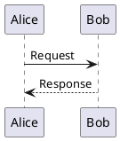

# 阅读排版、图表与选文助手

这些功能自 Inkleaf 0.5.3 提供，正式安装包以 [Releases](https://github.com/Fovercon/Inkleaf/releases/latest) 为准。

## 阅读排版

点击工具栏 **排版**，或在命令面板搜索“阅读排版”。默认最大宽度从 800 px 调整为 1000 px，左右留白为 24 px。

- 最大宽度可调为 640–1600 px，也可以铺满当前阅读区域。
- 左右留白可调为 12–64 px；窄窗口会自然收缩正文。
- 调整立即生效，自动保存在本机；“恢复默认”可回到初始排版。

## Graphviz：离线图表

插件中心中的 **Graphviz 图表 v1.0.0** 随软件提供，默认启用，无需安装 Graphviz 或联网。用 `dot` 或 `graphviz` 围栏：

````markdown

````

适合依赖关系、树、DAG、算法流程及结构图。点击图下“查看图表源码”可展开原始代码。停用插件后恢复为代码块，Markdown 文件不会被改写。

## PlantUML：本机或自建服务

插件中心选择 **PlantUML 图表 v1.0.0 → 图表服务设置**，填写服务根地址，例如本机服务 `http://localhost:8080`，或自建服务 `https://你的域名/plantuml`。服务器需要提供 PlantUML 标准 `/svg/编码` 接口。

应用不附带 Java 或 PlantUML 服务，也不会默认把文档发给公共服务器。保存地址后，打开或编辑包含 PlantUML 图表的文档时，对应代码会发送给你配置的服务器。请自行确认服务器的数据处理方式。本机运行方式见 [PlantUML PicoWeb](https://plantuml.com/picoweb)。

````markdown

````

也支持 `puml` 围栏。为限制外部资源访问，本版本不支持 `!include` / `!import` 等引用指令；需要外部 C4 库的图请先展开定义。服务器自身也应采用合适的 PlantUML 安全配置。HTTPS 和本机 HTTP 可用；重定向、带凭据的地址和普通远程 HTTP 不可用。

DOT 与 PlantUML 每个代码块最多 30000 字符，单次渲染超时约 15 秒。错误时保留代码并显示原因，不会阻断其他文字阅读。生成的图像可随 HTML / PDF 导出；SVG 中的脚本、外部图片和可跳转链接会移除。

## 统一模型连接

插件中心选择 **选文助手 v1.0.0 → 模型连接设置**。同一连接用于解释、翻译和总结。

| 连接类型 | 地址填写方式 | 模型 |
| --- | --- | --- |
| OpenAI 兼容服务 | 服务商提供的 API 根地址，通常以 `/v1` 结尾；应用追加 `/chat/completions` | 填写服务商的模型 ID |
| Ollama | 服务根地址，例如 `http://localhost:11434`；应用追加 `/api/chat` | 填写已安装的模型名称 |

本机 Ollama 需先自行安装并拉取模型，参见 [Ollama 文档](https://docs.ollama.com/quickstart)。本机服务通常不需要 API Key。兼容服务支持 Chat Completions 的 SSE 流式文本返回及普通 JSON 返回；并非所有模型或厂商的专属参数都兼容。应用不内置订阅和额度。

API Key 在主进程中使用。勾选记住时，使用系统安全存储加密后保存；系统安全存储不可用时，仅保留到本次退出，不会明文回退。界面与外部插件无法取回 Key。修改连接类型或服务地址会清除旧 Key，需重新输入；勾选“清除已保存的 Key”可主动移除。

## 解释、翻译与总结

1. 在阅读视图或编辑器中选中文字。
2. 点击工具栏 **助手**，或从“创作与知识工具”选择解释、翻译、总结。
3. 检查显示的选文、模型与服务地址，点击 **发送选文**。
4. 查看流式结果，可取消、复制，或主动选择插入选文后 / 替换选文。

每次只发送显示的选文、操作提示和翻译目标语言，不发送文档路径或整库内容。单次最多 20000 字符，请求超时约 90 秒。取消和失败后的部分结果可复制，但不能写回；请重试后再应用。

写回前会比较文档身份与原文；文档已变化时会保留结果并拒绝覆盖。阅读视图中的格式化选文有时无法唯一定位 Markdown 源码，此时支持复制结果；如需写回，可到编辑器重新选择。写回使用既有自动保存和本机历史。

生成内容可能不准确，请核对后使用。目前不包含联网百科检索、整库分析、D2 或 WaveDrom。
