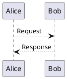

# 阅读排版、图表与选文助手

阅读排版和基础图表能力自 Inkleaf 0.5.3 提供；图表服务预设、划词翻译与问询侧栏自 0.5.4 提供。正式安装包以 [Releases](https://github.com/Fovercon/Inkleaf/releases/latest) 为准。

## 阅读排版

点击工具栏 **排版**，或在命令面板搜索“阅读排版”。默认最大宽度从 800 px 调整为 1000 px，左右留白为 24 px。

- 最大宽度可调为 640–1600 px，也可以铺满当前阅读区域。
- 左右留白可调为 12–64 px；窄窗口会自然收缩正文。
- 调整立即生效，自动保存在本机；“恢复默认”可回到初始排版。

## Graphviz：离线图表

插件中心中的 **Graphviz 图表 v1.0.0** 随软件提供，默认启用，无需安装 Graphviz 或联网。用 `dot` 或 `graphviz` 围栏：

````markdown

````

适合依赖关系、树、DAG、算法流程及结构图。点击图下“查看图表源码”可展开原始代码。停用插件后恢复为代码块，Markdown 文件不会被改写。

## PlantUML：免费服务、本机或自建

点击 **创作与知识工具 → 图表服务**，也可从 PlantUML 插件的命令打开。选择预设后可点击 **测试连接**；测试只发送固定的 Alice/Bob 演示图，不改变配置和当前文档。确认可用后点击 **保存设置** 用于文档。

| 预设 | 根地址 | 协议 |
| --- | --- | --- |
| PlantUML 官方免费公共服务 | `https://www.plantuml.com/plantuml` | PlantUML 标准服务 |
| Kroki 免费公共服务 | `https://kroki.io` | Kroki API |
| 本机 PlantUML | `http://localhost:8080` | PlantUML 标准服务 |
| 自定义 | 你的 HTTPS / 本机 HTTP 地址 | 按实际服务选择 |

两个公共预设均不需要自己写服务器。PlantUML 的官方服务说明见 [PlantUML Server](https://plantuml.com/server)，Kroki 的免费服务说明见 [Kroki](https://kroki.io/)。公共服务可用性由服务方提供，应用不会在故障时自动切换到另一服务。

首次打开设置会预填官方服务，**保存后才会联网渲染**。保存地址后，打开或编辑文档时，PlantUML 代码会发送到所选服务器；保密图表建议使用本机或自建服务。点击“停用联网图表”可清空地址。Graphviz 和 Mermaid 始终离线，不需要配置远程服务。应用不附带 Java；本机运行方式见 [PlantUML PicoWeb](https://plantuml.com/picoweb)。

````markdown

````

也支持 `puml` 围栏。为限制外部资源访问，本版本不支持 `!include` / `!import` 等引用指令；需要外部 C4 库的图请先展开定义。服务器自身也应采用合适的 PlantUML 安全配置。HTTPS 和本机 HTTP 可用；重定向、带凭据的地址和普通远程 HTTP 不可用。

DOT 与 PlantUML 每个代码块最多 30000 字符，单次渲染超时约 15 秒。错误时保留代码并显示原因，不会阻断其他文字阅读。生成的图像可随 HTML / PDF 导出；SVG 中的脚本、外部图片和可跳转链接会移除。

## 模型连接：应用基础能力

点击工具栏 **模型**，或从命令面板选择 **模型连接（应用基础能力）**。这项设置独立于插件，共用于划词翻译、AI 问询及后续内置功能。两个 AI 插件均停用时仍可配置；原版选文助手的连接和密钥继续使用，无需迁移账号。

| 连接类型 | 地址填写方式 | 模型 |
| --- | --- | --- |
| OpenAI 兼容服务 | 服务商的 API 根地址，通常以 `/v1` 结尾；应用追加 `/chat/completions` | 服务商的模型 ID |
| Ollama | 例如 `http://localhost:11434`；应用追加 `/api/chat` | 已安装的本机模型名称 |

本机 Ollama 需先安装并拉取模型，参见 [Ollama 文档](https://docs.ollama.com/quickstart)。本机服务通常不需要 API Key。兼容服务支持 Chat Completions 的 SSE 流式文本返回及普通 JSON 返回；应用不内置订阅和额度。

Key 仅由主进程使用。使用系统安全存储加密保存；加密不可用时仅本次运行有效，不明文回退。界面与外部插件无法取回 Key。修改连接类型或地址会清除旧 Key；勾选“清除已保存的 Key”可移除。图表设置和模型设置分别保存，不会互相覆盖连接或凭据。

## 划词翻译

1. 在插件中心启用 **划词翻译**，设置应用级模型连接。
2. 在阅读视图或编辑器选中文字，旁边出现 **翻译 / 解释 / 总结** 操作条（只显示已启用功能）。
3. 点击 **翻译**，就近打开小浮窗并开始翻译。可切换语言后重新翻译、停止或复制译文。
4. 若希望划词后直接翻译，在 **划词翻译设置 → 选中即译** 开启；完成选择后才请求，拖动选择过程中不发送。默认关闭，正在问询时仍显示操作条。
5. 在源位置可唯一定位时，可主动选择 **替换选文**；修改过文档后会拒绝覆盖，译文仍可复制。

点击浮窗外、滚动正文、调整窗口或切换文档会关闭浮窗并取消未完成请求。停用翻译不会影响 AI 问询或模型连接。目标语言和“选中即译”偏好仅保存在本机。

## AI 问询侧栏

点击选文操作条的 **解释 / 总结**，或工具栏 **问询**，会在右侧展开并处理选文。侧栏显示固定的引用范围、模型与服务地址；在输入框中可继续追问，用发送按钮或 Cmd/Ctrl+Enter 发送。**新对话** 清空当前对话，引用选文保持不变；选择新内容后再次解释会开始新的会话。

- 回复支持 Markdown、代码块、表格及 `$...$` / `$$...$$` 公式。
- 图片首先显示 **加载图片** 按钮和目标域名，点击后才访问 HTTPS 图片；不会读取模型指定的本地文件或执行生成的 HTML / 脚本。此功能呈现引用图片，不生成或搜索图片。
- 只发送固定引用选文、用户问题和当前成功的对话轮次；不发送文件路径、整篇文档或整库。一次选文最多 20000 字符，问题最多 4000 字符；较早的对话会在上下文达到限制时移除并提示。
- 请求可停止，失败问题保留，可重试；失败或取消的部分回答不会成为下次请求的成功历史，也不能写回文档。
- 可复制回答或主动 **插入选文后**，写回前比较文件身份和原内容。阅读视图中格式化选文无法唯一映射源码时，只提供复制。
- 对话仅在当前侧栏内保留，关闭、切换文档或停用问询插件会取消请求并清除会话。应用当前每个窗口只运行一个模型请求。

生成内容可能不准确，请核对后使用。目前不包含联网百科检索、整库分析、D2 或 WaveDrom。

## 给后续功能开发者

网络、地址验证、密钥与流解析集中在 `main/services-host` 与 `main/service-core`；`shared/services` 定义有界请求，`renderer/modelClient` 管理任务生命周期。应用功能可创建模型会话；可信内置插件声明 `model` 权限并通过 `ink.model.createSession()` 使用共用连接，停用时自动清理会话，不接触凭据。

隔离的外部插件 SDK 目前仍只允许 `render` 和 `commands`，没有无提示调用模型的桥接。以后开放外部模型 API 时应增加明确的授权与调用限额，不能让插件拿到 Key 或任意网络权限。
