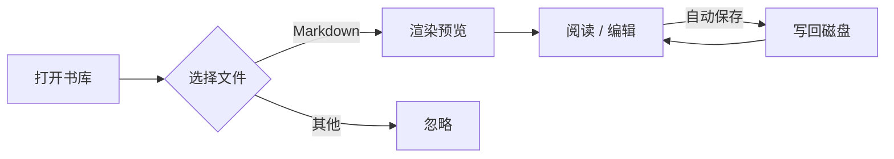
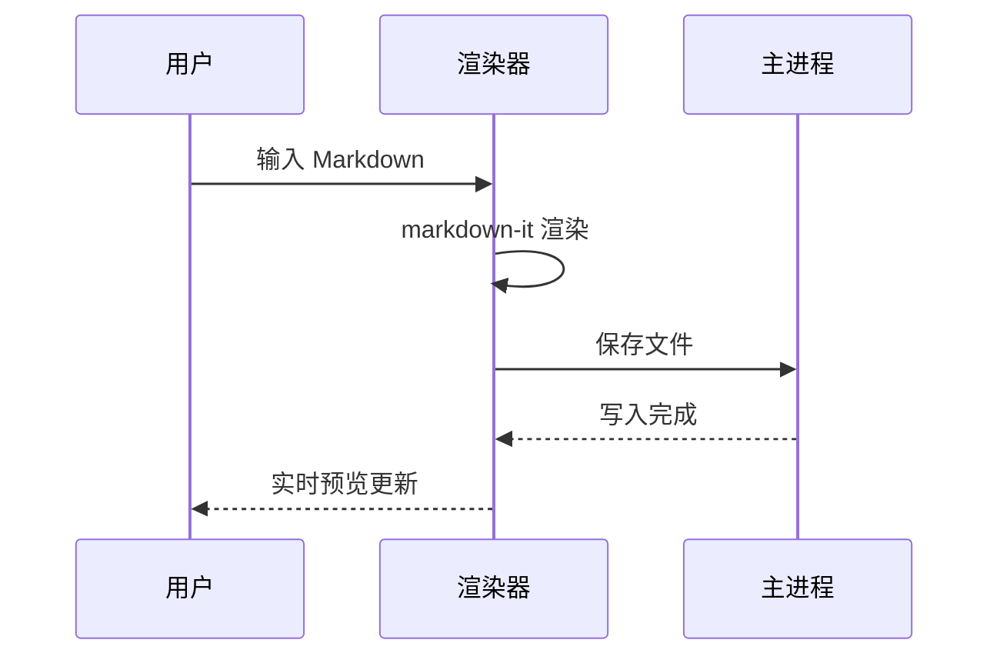

# Markdown Reader 功能演示

这是一个覆盖全部渲染特性的演示文档，用于验证阅读器的排版效果。

## 文字样式

普通段落文字，包含 **加粗**、*斜体*、***粗斜体***、`行内代码`、~~删除线~~ 和 [外部链接](https://commonmark.org)。

中文排版测试：床前明月光，疑是地上霜。举头望明月，低头思故乡。

## 列表与任务

无序列表：

- 第一项
- 第二项
  - 嵌套项 A
  - 嵌套项 B
- 第三项

有序列表：

1. 准备阶段
2. 实施阶段
3. 验收阶段

任务列表：

- [x] 完成需求分析
- [x] 搭建项目骨架
- [ ] 实现渲染管线
- [ ] 打磨交互细节

## 表格

| 功能 | 状态 | 说明 |
| ---- | :--: | ---- |
| Markdown 渲染 | ✅ | GFM 全语法 |
| 数学公式 | ✅ | KaTeX |
| 图表 | ✅ | Mermaid |
| 导出 | 🚧 | 后续版本 |

> 引用块：简单胜于复杂（Simple is better than complex）。
> —— The Zen of Python

## 代码高亮

```typescript
interface Library {
  root: string
  files: string[]
}

export async function loadLibrary(root: string): Promise<Library> {
  const files = await walk(root, '*.md')
  return { root, files }
}
```

```python
def fibonacci(n: int) -> list[int]:
    seq = [0, 1]
    while len(seq) < n:
        seq.append(seq[-1] + seq[-2])
    return seq[:n]

print(fibonacci(10))  # [0, 1, 1, 2, 3, 5, 8, 13, 21, 34]
```

## 数学公式

行内公式：质能方程 $E = mc^2$，欧拉恒等式 $e^{i\pi} + 1 = 0$。

块级公式：

$$
\int_{-\infty}^{\infty} e^{-x^2} \, dx = \sqrt{\pi}
$$

$$
\sum_{n=1}^{\infty} \frac{1}{n^2} = \frac{\pi^2}{6}
$$

## Mermaid 图表





## 图片

相对路径图片（来自书库 assets 目录）：


## 分割线

---

文档结束。左侧编辑面板可修改本文档，右侧预览会实时刷新。
