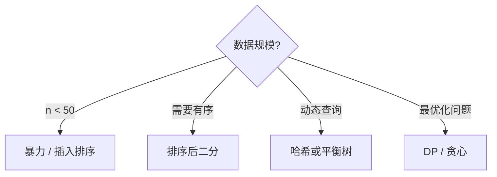

# 算法笔记

## 复杂度速查

| 结构 | 查找 | 插入 | 删除 |
| ---- | ---- | ---- | ---- |
| 数组 | $O(n)$ | $O(1)$ | $O(n)$ |
| 哈希表 | $O(1)$ | $O(1)$ | $O(1)$ |
| 平衡树 | $O(\log n)$ | $O(\log n)$ | $O(\log n)$ |

## 主定理

对于分治递推 $T(n) = aT(n/b) + f(n)$：

$$
T(n) = \begin{cases}
\Theta(n^{\log_b a}) & f(n) = O(n^{\log_b a - \varepsilon}) \\
\Theta(n^{\log_b a} \log n) & f(n) = \Theta(n^{\log_b a}) \\
\Theta(f(n)) & f(n) = \Omega(n^{\log_b a + \varepsilon})
\end{cases}
$$

## 快速排序

```javascript
function quicksort(arr, lo = 0, hi = arr.length - 1) {
  if (lo >= hi) return arr
  const p = partition(arr, lo, hi)
  quicksort(arr, lo, p - 1)
  quicksort(arr, p + 1, hi)
  return arr
}

function partition(arr, lo, hi) {
  const pivot = arr[hi]
  let i = lo
  for (let j = lo; j < hi; j++) {
    if (arr[j] < pivot) [arr[i], arr[j]] = [arr[j], arr[i]], i++
  }
  ;[arr[i], arr[hi]] = [arr[hi], arr[i]]
  return i
}
```

平均时间复杂度 $O(n \log n)$，最坏 $O(n^2)$（已有序输入）。

## 决策流程


